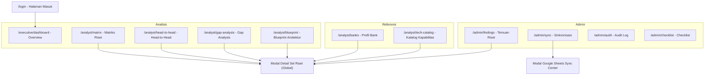

# PRD – Competitor Intelligence: Tech Stack Bank BRI vs Himbara & BCA

| Atribut | Nilai |
| --- | --- |
| **Versi dokumen** | 1.1 (As-Built) |
| **Tanggal** | 21 Oktober 2026 |
| **Status** | Final untuk review – mendeskripsikan produk yang **sudah terbangun dan terintegrasi penuh** |
| **Menggantikan** | `PRD_v1.0_Competitor_Intelligence_BRI_As-Built.md` (v1.0, 19 Okt 2026) dan `Draft v0.1` (13 Okt 2026) |
| **Dokumen terkait** | `README.md`, `REKOMENDASI_IMPROVEMENT_DAN_ROADMAP_FITUR.md` |
| **Repositori** | `competitor-intelligence-bri` (v1.0.0) |

> **Catatan pembaca:** Dokumen ini disusun dengan membedah kode sumber aplikasi terkini (frontend React 18, backend Express, endpoints serverless Vercel, skema SQLite, scheduler auto-sync background, dan dataset riset terverifikasi per 21 Oktober 2026). Bagian 18 merangkum jejak evolusi fitur dari Draft v0.1 hingga As-Built v1.1, sedangkan Bagian 17 memuat status *known issues* dan resolusi teknis terbaru.

---

## Daftar Isi

1. [Ringkasan Produk](#1-ringkasan-produk)
2. [Latar Belakang & Masalah](#2-latar-belakang--masalah)
3. [Tujuan & Non-Tujuan](#3-tujuan--non-tujuan)
4. [Target Pengguna & Persona](#4-target-pengguna--persona)
5. [Cakupan & Taksonomi Data](#5-cakupan--taksonomi-data)
6. [Model Status Verifikasi & Snapshot Data](#6-model-status-verifikasi--snapshot-data)
7. [Arsitektur Informasi & Navigasi](#7-arsitektur-informasi--navigasi)
8. [Kebutuhan Fungsional & Penjelasan Detail Seluruh Fitur](#8-kebutuhan-fungsional--penjelasan-detail-seluruh-fitur)
9. [Aturan Bisnis & Logika Kalkulasi](#9-aturan-bisnis--logika-kalkulasi)
10. [User Stories & Acceptance Criteria](#10-user-stories--acceptance-criteria)
11. [Model Data](#11-model-data)
12. [Spesifikasi API](#12-spesifikasi-api)
13. [Arsitektur Teknis & Deployment](#13-arsitektur-teknis--deployment)
14. [Kebutuhan Non-Fungsional](#14-kebutuhan-non-fungsional)
15. [Pertimbangan Legal, Etika & Privasi](#15-pertimbangan-legal-etika--privasi)
16. [Metrik Keberhasilan](#16-metrik-keberhasilan)
17. [Known Issues & Technical Debt](#17-known-issues--technical-debt)
18. [Traceability: Evolusi Draft v0.1 s/d As-Built v1.1](#18-traceability-evolusi-draft-v01-sd-as-built-v11)
19. [Roadmap Lanjutan](#19-roadmap-lanjutan)
20. [Risiko & Mitigasi](#20-risiko--mitigasi)
21. [Keputusan & Pertanyaan Terbuka](#21-keputusan--pertanyaan-terbuka)
22. [Lampiran: Glosarium](#22-lampiran-glosarium)

---

## 1. Ringkasan Produk

**Competitor Intel** adalah aplikasi web *evidence-based competitor intelligence* yang memetakan dan membandingkan **tech stack Bank BRI** terhadap **4 bank Himbara (Mandiri, BNI, BTN, BSI) dan BCA**. Data riset tersusun sebagai matriks **409 kapabilitas × 6 bank = 2.454 sel evaluasi**, dikelompokkan ke dalam **Pilar Workshop Dinamis (WS1–WS5)**, **14 domain arsitektur**, dan **10 kategori**.

Setiap sel berisi: *merk/stack* yang digunakan bank, *link/sumber bukti publik*, *PIC* pencatat riset, dan **status verifikasi** (`Terverifikasi` / `Inferensi` / `Belum`).

**Value proposition:**
> Satu tempat terpusat untuk memetakan, membandingkan, dan mempresentasikan lanskap teknologi BRI vs kompetitor secara terstruktur, dapat ditelusuri ke sumber pembuktian, dan siap disajikan langsung di hadapan pimpinan serta arsitek enterprise Bank BRI.

**Konteks penggunaan:** Dibangun oleh tim konsultan sebagai instrumen strategis **workshop arsitektur teknologi bersama BRI**. Sumber kebenaran data riset (*source of truth*) adalah **Google Spreadsheet riset tim**, yang disinkronkan secara dua arah dengan database aplikasi melalui integrasi otomatis, background scheduler, atau webhook Google Apps Script.

---

## 2. Latar Belakang & Masalah

| # | Masalah | Dampak |
| --- | --- | --- |
| 1 | Informasi tech stack bank tersebar di ratusan dokumen publik (laporan tahunan, siaran pers, studi kasus vendor, lowongan kerja, presentasi investor). | Benchmarking berjalan lambat, terfragmentasi, dan tidak konsisten. |
| 2 | Riset dikerjakan banyak PIC di spreadsheet yang sangat panjang (±2.500 baris). | Sulit dibaca, rentan salah filter, dan tidak layak dipresentasikan ke eksekutif. |
| 3 | Tidak ada cara instan menjawab *"Di mana BRI tertinggal?"*, *"Apa keunggulan eksklusif BRI?"*, *"Apa standar konsensus industri?"*. | Insight strategis tenggelam di balik tumpukan data mentah. |
| 4 | Klaim teknologi wajib dapat diaudit tautan sumbernya secara real-time saat diuji oleh peserta workshop. | Risiko kredibilitas tim konsultan di hadapan Dewan Direksi dan arsitek bank. |

---

## 3. Tujuan & Non-Tujuan

### 3.1 Tujuan Produk

| ID | Tujuan | Status As-Built v1.1 |
| --- | --- | --- |
| G1 | Menyajikan perbandingan 409 kapabilitas × 6 bank yang terkelompok per workshop dinamis/domain/kategori. | ✅ **Tercapai Penuh** (mendukung WS1 s/d WS5 secara dinamis) |
| G2 | Setiap sel memiliki status verifikasi resmi, tautan sumber primer, dan PIC pencatat. | ✅ **Tercapai** (ekstraksi URL otomatis & tautan langsung) |
| G3 | Kalkulasi otomatis: **gap teknologi BRI**, **keunggulan eksklusif (moat)**, dan **standar paritas industri**. | ✅ **Tercapai** |
| G4 | Perbandingan langsung dua bank (*Head-to-Head*) dan visualisasi arsitektur 5 layer (*Blueprint*). | ✅ **Tercapai Penuh** |
| G5 | Sinkronisasi dua arah dengan Google Sheets, background scheduler otomatis, dan audit trail log. | ✅ **Tercapai Penuh** (auto-sync saat startup, interval berkala, & log WIB) |
| G6 | Kesiapan presentasi langsung dari web browser pada proyektor workshop. | ✅ **Tercapai** (High-contrast solid UI, collapsible sidebar `Ctrl+B`, dark/light mode) |

### 3.2 Non-Tujuan

- Tidak melakukan pemindaian jaringan (*vulnerability scanning*) atau mengakses sistem internal bank.
- Tidak memuat detail celah keamanan siber yang dapat dieksploitasi (versi rentan, endpoint internal, token kredensial).
- Bukan alat audit kinerja finansial atau rasio keuangan bank.
- Tidak mencakup bank di luar 6 bank benchmark (bank asing/fintech) pada rilis v1.x.
- Tidak menyediakan skor numerik subjektif tanpa justifikasi bukti publik.

---

## 4. Target Pengguna & Persona

| Persona | Peran | Kebutuhan Utama | Modul yang Paling Sering Digunakan |
| --- | --- | --- | --- |
| **Konsultan / Admin Data** | Mengelola dataset, sinkronisasi, dan validasi | Input & koreksi cepat, sync Google Sheet, audit log, checklist kesiapan | Admin (Temuan, Sinkronisasi, Audit, Checklist) |
| **Tech/Research Analyst (PIC)** | Mengisi temuan per bank | Menemukan kapabilitas, mengisi merk + link pembuktian | Matriks Riset, Modal Detail Sel |
| **Enterprise Architect BRI** | Peserta workshop | Membandingkan stack per layer arsitektur & dependensi | Blueprint Arsitektur, Head-to-Head |
| **Strategy & Innovation BRI** | Peserta workshop | Mengidentifikasi gap teknologi untuk penyusunan roadmap | Overview, Gap Analysis |
| **Eksekutif / Direksi BRI** | Audiens presentasi | Ringkasan eksekutif, KPI tingkat verifikasi, keunggulan BRI | Overview, Profil Bank |

---

## 5. Cakupan & Taksonomi Data

### 5.1 Bank Terpantau (6 Bank)

| Kode | Nama Bank | Peran dalam Sistem | Fokus Profil & Produk Digital Utama |
| --- | --- | --- | --- |
| **BRI** | PT Bank Rakyat Indonesia (Persero) Tbk | **Fokus Utama** (Aksen Khusus) | Pemimpin mikro & ultra-mikro (*BRImo, Pasar.id, Sabrina, Qlola*) |
| **Mandiri** | PT Bank Mandiri (Persero) Tbk | Pembanding Utama | Ekosistem wholesale & lifestyle (*Livin' by Mandiri, Kopra*) |
| **BCA** | PT Bank Central Asia Tbk | Pembanding Swasta | Efisiensi transaksi & ekosistem ritel (*myBCA, KlikBCA Bisnis*) |
| **BNI** | PT Bank Negara Indonesia (Persero) Tbk | Pembanding Himbara | Transaksi global & consumer digital (*wondr by BNI*) |
| **BTN** | PT Bank Tabungan Negara (Persero) Tbk | Pembanding Himbara | Pembiayaan perumahan & ekosistem properti (*bale by BTN*) |
| **BSI** | PT Bank Syariah Indonesia Tbk | Pembanding Syariah | Bank syariah terbesar & digital banking syariah (*BYOND by BSI*) |

### 5.2 Pilar Workshop Dinamis (WS)

Daftar workshop diekstrak secara dinamis (*data-driven*) dari dataset riset:

| Kode WS | Nama Pilar Workshop | Jumlah Kapabilitas | Cakupan Domain Utama |
| --- | --- | :---: | --- |
| **WS1** | Core & Digital Banking | 124 | Core Banking System (CBS), Mobile Banking, Internet Banking, Digital Banking |
| **WS2** | EDW, MDM & BI Analytics | 90 | Enterprise Data Warehouse (EDW), Master Data Management (MDM), Business Intelligence (BI) |
| **WS3** | Cloud, Infra & ITSM/Observability | 132 | Cloud Technology, Infrastructure, Network, IT Support (ITSM) |
| **WS4** | Big Data, AI & ML | 62 | Big Data Analytics, AI Technology |
| **WS5** | Security, Governance & Custom | 1 | IT Security & Tata Kelola Keamanan Khusus |
| | **Total Keseluruhan** | **409** | **14 domain arsitektur** |

### 5.3 Domain Arsitektur (14 Domain)

| # | Domain Arsitektur | Pilar WS | Kapabilitas |
| :---: | --- | :---: | :---: |
| 1 | Core Banking System (CBS) | WS1 | 32 |
| 2 | Mobile Banking | WS1 | 31 |
| 3 | Internet Banking | WS1 | 31 |
| 4 | Digital Banking | WS1 | 30 |
| 5 | Enterprise Data Warehouse (EDW) | WS2 | 30 |
| 6 | Master Data Management (MDM) | WS2 | 30 |
| 7 | Business Intelligence (BI) | WS2 | 30 |
| 8 | Cloud Technology | WS3 | 30 |
| 9 | Infrastructure | WS3 | 31 |
| 10 | Network | WS3 | 34 |
| 11 | IT Support (ITSM) | WS3 | 37 |
| 12 | Big Data Analytics | WS4 | 31 |
| 13 | AI Technology | WS4 | 31 |
| 14 | IT Security | WS5 | 1 |

### 5.4 Kategori Teknologi (10 Kategori)

| Kategori | Jumlah | Kategori | Jumlah |
| --- | :---: | --- | :---: |
| Software/Sistem | 205 | Standar/Protokol | 28 |
| Keamanan | 46 | Metrik/Benchmark | 18 |
| Arsitektur | 35 | Layanan/Komersial | 14 |
| Tool | 28 | Regulasi | 6 |
| Hardware | 28 | Standar & Regulasi | 1 |

---

## 6. Model Status Verifikasi & Snapshot Data

### 6.1 Definisi Status Verifikasi

| Status | Label UI | Definisi Pembuktian | Visual |
| --- | --- | --- | --- |
| `Terverifikasi` | ✓ Terverifikasi | Didukung oleh bukti primer legal: laporan tahunan resmi, studi kasus vendor resmi (AWS/Red Hat/Oracle), siaran pers korporat, dokumentasi Bank Indonesia, atau rekaman wawancara internal. | Badge Hijau (`ok`) |
| `Inferensi` | ⚠ Inferensi | Indikasi kuat dari kombinasi lowongan kerja teknis, sertifikasi profesional pegawai, atau keterhubungan pihak ketiga. | Badge Kuning (`warn`) |
| `Belum` | – Belum | Belum terdeteksi atau bank bersangkutan belum mengadopsi solusi di kapabilitas tersebut. | Badge Abu-abu |

> **Prinsip Perhitungan:** Seluruh kalkulasi insight strategis (gap analisis, keunggulan eksklusif, dan konsensus paritas) **hanya memperhitungkan status `Terverifikasi`** guna menjaga integritas dan akuntabilitas presentasi di hadapan manajemen perbankan.

### 6.2 Snapshot Data Riset Terverifikasi (per 21 Oktober 2026)

| Bank | Terverifikasi | Inferensi | Belum | % Terverifikasi |
| --- | :---: | :---: | :---: | :---: |
| **Bank BRI** (Fokus) | **83** | **14** | **312** | **20,3%** |
| Bank Mandiri | 79 | 10 | 320 | 19,3% |
| Bank Central Asia (BCA) | 77 | 7 | 325 | 18,8% |
| Bank BNI | 70 | 11 | 328 | 17,1% |
| Bank Syariah Indonesia (BSI) | 42 | 14 | 353 | 10,3% |
| Bank BTN | 29 | 4 | 376 | 7,1% |
| **Total Agregat Industri** | **380** | **60** | **2.014** | **15,5%** |

**Progres Signifikan per 21 Oktober 2026:**
- Total sel terverifikasi meningkat dari **208 sel (8,5%)** pada baseline 19 Oktober menjadi **380 sel (15,5%)**.
- Total sel terisi (`Terverifikasi` + `Inferensi`) mencapai **440 dari 2.454 sel (17,9%)**.
- Tingkat pembuktian Bank BRI memimpin di angka **20,3% (83 kapabilitas)**, disusul ketat oleh Bank Mandiri (19,3%) dan BCA (18,8%).

---

## 7. Arsitektur Informasi & Navigasi

Aplikasi berupa Single Page Application (SPA) responsif dengan routing berbasis push-state dan context management terpusat:

### Navigasi Sidebar & Header

| Grup Navigasi | Menu Item | Rute Path | Keterangan & Indikator |
| --- | --- | --- | --- |
| **Analisis** | Overview | `/executive/dashboard` | Dashboard KPI eksekutif & strategic highlights |
| | Matriks riset | `/analyst/matrix` | Tabel 409 × 6 dengan badge hitungan data |
| | Head-to-head | `/analyst/head-to-head` | Komparasi 1-on-1 dengan alignment score |
| | Gap analysis | `/analyst/gap-analysis` | Pemetaan celah arsitektur prioritas (Tinggi/Sedang/Rendah) |
| | Blueprint arsitektur | `/analyst/blueprint` | Visualizer interaktif 5 layer arsitektur perbankan |
| **Referensi** | Profil bank | `/analyst/banks` | Detail 6 bank, produk digital, & riwayat bukti |
| | Katalog kapabilitas | `/analyst/tech-catalog` | Katalog teknologi berfilter lisensi & kategori |
| **Admin** | Temuan riset | `/admin/findings` | Manajemen CRUD kapabilitas riset baru |
| | Sinkronisasi | `/admin/sync` | Pusat kontrol live sync Google Sheets & background poller |
| | Audit log | `/admin/audit` | Riwayat aktivitas sistem dengan stempel waktu WIB |
| | Checklist | `/admin/checklist` | Verifikasi 4 gerbang mutu kesiapan workshop |

---

## 8. Kebutuhan Fungsional & Penjelasan Detail Seluruh Fitur

### F1. Executive Dashboard Overview (P0)
- **Rute:** `/executive/dashboard`
- **KPI Metrics:** Total kapabilitas terpetakan (409), persentase verifikasi per bank, rasio verifikasi industri, dan gap aktif BRI.
- **Strategic Highlights Tiga Pilar:**
  - *Hanya BRI (Moat):* Kapabilitas skala ultra-mikro (Cassandra multi-nodes, MinIO S3, NLP Sabrina).
  - *Celah / Peluang Kompetitor:* Stack Livin' Sukha AWS hybrid, Dataiku collaborative data science, HashiCorp Vault.
  - *Standar Konsensus Industri:* Solusi bersama (OpenShift, Kafka, Spring Boot, SNAP BI-FAST).
- **Heatmap Domain:** Baris progres adopsi teknologi per domain arsitektur.

### F2. Matriks Riset Interaktif / Matrix View (P0 - Fitur Inti)
- **Rute:** `/analyst/matrix`
- **Matriks 409 Kapabilitas × 6 Bank:** Kolom Bank BRI ditandai khusus sebagai fokus utama evaluasi.
- **Unified Filter Panel:**
  - Dropdown **Pilar Workshop Dinamis** (WS1–WS5 & custom workshops).
  - Filter Domain & Kategori Arsitektur.
  - Filter Status Verifikasi (`Semua`, `Terverifikasi Saja`, dll.).
  - Pencarian teks instan (nama kapabilitas, merk, atau kata kunci stack).
- **Drawer Audit Detail Sel:** Menampilkan merk, link URL rujukan, PIC, tanggal verifikasi, status, dan tombol navigasi langsung ke URL pembuktian.
- **Ekspor CSV:** Unduh format data matriks presisi untuk analisis spreadsheet offline.

### F3. Head-to-Head Diff View (P0)
- **Rute:** `/analyst/head-to-head`
- **Pilihan Komparasi:** BRI vs Mandiri, BCA, BNI, BTN, atau BSI.
- **Kalkulasi Otomatis:**
  - *Architecture Alignment Score* (% kesamaan teknologi yang dipakai).
  - *Keunggulan Eksklusif BRI* (teknologi terverifikasi di BRI tapi lawan belum mengadopsi).
  - *Kesenjangan Arsitektur (Gaps)* (teknologi lawan yang belum terbukti di BRI).

### F4. Blueprint Arsitektur 5-Layer (P0)
- **Rute:** `/analyst/blueprint`
- **Visualisasi 5 Lapisan Arsitektur Perbankan:**
  1. *Touchpoint & Digital Channels* (Consumer SuperApp, Wholesale CMS/Qlola, SNAP BI Gateway)
  2. *Integration & Middleware Orchestration* (Enterprise API Gateway, Event Streaming/Kafka, Microservices Mesh)
  3. *Core Financial Processing & Operations* (Core Banking System, Card Management, Settlement)
  4. *Enterprise Data Platform & AI Intelligence* (Data Lakehouse, Real-Time BI & Analytics, AI/ML Platform)
  5. *Cloud Foundation, Infrastructure & Security* (Hybrid Cloud, Kubernetes/OpenShift, Distributed DB, Zero Trust)
- **Blok Interaktif:** Setiap blok dapat diklik untuk membuka perbandingan adopsi lintas 6 bank.

### F5. Gap Analysis & Rekomendasi Roadmap (P1)
- **Rute:** `/analyst/gap-analysis`
- **Matriks Urgensi Gap:** Menghitung kapabilitas di mana kompetitor telah mengadopsi teknologi modern dan menandainya dengan skala prioritas (Tinggi, Sedang, Rendah).
- **Rekomendasi Taktis:** Poin aksi spesifik bagi tim Enterprise Architecture Bank BRI.

### F6. Profil Bank & Katalog Kapabilitas (P1)
- **Rute:** `/analyst/banks` & `/analyst/tech-catalog`
- Profil 6 bank benchmark dengan warna perseroan, produk digital, dan riwayat temuan.
- Katalog master teknologi dengan filter kategori, vendor, dan model lisensi (*Open Source*, *Komersial Enterprise*, *In-House*).

### F7. Admin CMS & Manajemen Temuan Riset (P0)
- **Rute:** `/admin/findings`
- Penambahan kapabilitas baru dengan penomoran otomatis.
- Pemetaan merk dan status verifikasi untuk ke-6 bank.
- Validasi data masukan dan konfirmasi penghapusan aman.

### F8. Google Sheets Live Sync Center (2-Way Sync) (P0)
- **Rute:** `/admin/sync` & Modal Global
- **Pull Sync:** Menarik pembaruan dari Google Spreadsheet publik ke SQLite secara instan.
- **Push Sync:** Mengirimkan data perubahan aplikasi ke Google Sheet menggunakan Webhook Google Apps Script (`scripts/google_apps_script.js`).
- **1-Klik Salin Format:** Menyalin seluruh matriks yang telah diformat rapi untuk di-paste langsung pada sel A1 spreadsheet.
- **Active Background Scheduler:** Berjalan otomatis saat startup dan mengeksekusi sinkronisasi berulang di latar belakang sesuai interval yang dipilih (`5 menit`, `15 menit`, `30 menit`, `1 jam`, atau `Manual`).
- **Dynamic Storage Indicator:** Badge status otomatis mendeteksi koneksi SQLite Server atau mode cadangan LocalStorage.
- **Dukungan Serverless:** Endpoint Vercel Serverless (`/api/sync/pull`, `/api/sync/push`, `/api/sync/config`, `/api/sync/status`).

### F9. Audit Trail Log dengan Lokalisasi Waktu WIB (P1)
- **Rute:** `/admin/audit`
- Mencatat setiap aksi `CREATE`, `UPDATE`, `DELETE`, `SYNC`, dan `LOGIN`.
- **Stempel Waktu Terlokalisasi WIB (UTC+7):** Waktu aktivitas dikonversi secara otomatis ke Waktu Indonesia Barat.
- Pencarian dan penyaringan riwayat log berdasarkan jenis aksi dan kata kunci.

### F10. Checklist Kesiapan Workshop (P1)
- **Rute:** `/admin/checklist`
- Kendali mutu sebelum presentasi ke hadapan pimpinan BRI: kelengkapan bukti, rasio verifikasi, kepatuhan UU PDP, dan integritas data.

### F11. Cadangan, Pemulihan Basis Data & Reset (P1)
- Ekspor arsip JSON lengkap dari seluruh basis data.
- Impor berkas cadangan JSON dengan perlindungan null-safety defensif.
- Reset basis data darurat ke bibit data bawaan (*factory seed*).

---

## 9. Aturan Bisnis & Logika Kalkulasi

Notasi: `V(bank)` = sel bank berstatus `Terverifikasi`; `K` = himpunan 5 bank kompetitor.

| Formula Bisnis | Rumus Logika | Penggunaan di Modul |
| --- | --- | --- |
| **% Terverifikasi Bank** | `jumlah V(bank) / total kapabilitas (409)` | Overview, Profil Bank |
| **Rata-rata Verifikasi Industri** | `total V(semua bank) / (409 × 6)` | Overview KPI |
| **Gap Teknologi BRI** | `¬V(BRI) ∧ ∃k∈K: V(k)` | Overview, Gap Analysis |
| **Tingkat Urgensi Gap** | `Tinggi` bila ≥2 kompetitor V; selain itu `Sedang` | Gap Analysis |
| **Keunggulan Eksklusif BRI (Moat)** | `V(BRI) ∧ ∀k∈K: ¬V(k)` | Overview, Gap Analysis |
| **Standar Konsensus Paritas** | `V(BRI) ∧ |{k∈K: V(k)}| ≥ 2` | Overview, Gap Analysis |
| **Paritas Head-to-Head** | `V(A) ∧ V(B)` → Paritas Bersama; `V(A) ∧ ¬V(B)` → Unggul A; `¬V(A) ∧ V(B)` → Unggul B; lainnya → *Beda Solusi* / `–` | Head-to-Head, Blueprint |

---

## 10. User Stories & Acceptance Criteria

| ID | User Story | Acceptance Criteria | Modul Terkait |
| --- | --- | --- | --- |
| **US-01** | Sebagai **Direksi/Arsitek BRI**, saya ingin melihat posisi teknologi BRI vs 5 kompetitor dalam satu layar. | KPI, rasio verifikasi, dan keunggulan eksklusif tampil < 2 detik setelah login; angka konsisten dengan Matriks. | F1 (Overview) |
| **US-02** | Sebagai **Analis Riset**, saya ingin memfilter 409 kapabilitas per workshop dinamis/domain/status secara terpadu. | Dropdown workshop mengekstrak seluruh WS secara dinamis; filter kombinasi bekerja simultan dan dapat di-reset. | F2 (Matriks) |
| **US-03** | Sebagai **Arsitek**, saya ingin mengeklik sel matriks untuk memverifikasi tautan sumber bukti primer. | Modal membuka informasi merk, link rujukan, PIC, status, dan membuka URL sumber di tab baru. | F2 (Modal Detail) |
| **US-04** | Sebagai **PIC Riset**, saya ingin memperbarui data sel secara langsung dan tersimpan ke database. | Perubahan langsung tercermin di UI dan dicatat dalam audit trail log dengan stempel waktu WIB. | F2, F7, F9 |
| **US-05** | Sebagai **Enterprise Architect**, saya ingin membandingkan lanskap teknologi dalam bentuk diagram layer arsitektur. | 5 layer arsitektur interaktif dapat diinspeksi per blok untuk melihat adopsi lintas 6 bank. | F4 (Blueprint) |
| **US-06** | Sebagai **Admin Riset**, saya ingin sistem melakukan sinkronisasi otomatis dengan Google Sheet di latar belakang. | Auto-sync scheduler berjalan saat startup dan berulang sesuai interval tersimpan (5m/15m/30m/1h). | F8 (Sync Center) |

---

## 11. Model Data

### 11.1 Entitas Utama: `research_records` (SQLite)
Menyimpan matriks riset 409 kapabilitas × 6 bank (2.454 rekaman):

| Kolom | Tipe Data | Keterangan |
| --- | --- | --- |
| `id` | TEXT PRIMARY KEY | Format: `rec-{no}-{bankKey}` |
| `no` | INTEGER | Nomor urut kapabilitas (1 s/d 409) |
| `workshop` | TEXT | Kode pilar workshop (`WS1`–`WS5`) |
| `domain` | TEXT | Salah satu dari 14 domain arsitektur |
| `kategori` | TEXT | Salah satu dari 10 kategori arsitektur |
| `kapabilitas` | TEXT | Nama kapabilitas sistem yang dievaluasi |
| `bankCode` | TEXT | `BRI`, `Mandiri`, `BCA`, `BNI`, `BTN`, `BSI` |
| `bankId` | TEXT | Slug bank (`bank-bri`, `bank-mandiri`, dst.) |
| `merk` | TEXT | Merk/teknologi yang digunakan bank |
| `link` | TEXT | Teks kutipan bukti atau URL rujukan |
| `url` | TEXT | Ekstraksi URL primer pertama |
| `pic` | TEXT | Inisial/nama analis riset pencatat |
| `status` | TEXT | `Terverifikasi` / `Inferensi` / `Belum` |

### 11.2 Tabel Pendukung Sistem
- `banks`: Profil 6 bank, warna identitas, dan produk digital.
- `users`: Kredensial pengguna admin.
- `audit_logs`: Jejak modifikasi data dengan format waktu WIB.
- `sync_settings`: Konfigurasi Google Sheets, interval scheduler, dan URL webhook Apps Script.
- `sync_history`: Catatan 50 riwayat aktivitas sinkronisasi terakhir.

---

## 12. Spesifikasi API

Base URL Backend Express: `http://<host>:3000/api`  
Base URL Serverless Vercel: `/api/sync/*`

### 12.1 Matriks Riset
- `GET /api/research-matrix`: Mengambil seluruh 409 kapabilitas × 6 bank.
- `POST /api/research-matrix`: Menambah kapabilitas baru beserta evaluasi 6 bank.
- `PUT /api/research-matrix/:capId`: Mengubah metadata kapabilitas.
- `PUT /api/research-matrix/:capId/:bankCode`: Mengubah isi sel bank spesifik.
- `DELETE /api/research-matrix/:capId`: Menghapus kapabilitas beserta 6 entri bank.

### 12.2 Sinkronisasi Google Sheets (Express & Vercel Serverless Ready)
- `GET /api/sync/status`: Membaca status koneksi, interval scheduler, dan total rekaman.
- `POST /api/sync/pull`: Menjalankan sinkronisasi tarik data dari spreadsheet publik.
- `POST /api/sync/push`: Mengirim perubahan data ke webhook Google Apps Script.
- `POST /api/sync/config`: Menyimpan konfigurasi URL sheet, webhook, dan auto-sync interval.
- `GET /api/sync/history`: Mengambil riwayat aktivitas sinkronisasi.
- `GET /api/sync/export-csv`: Mengunduh berkas CSV terstruktur presisi format spreadsheet.

### 12.3 Autentikasi & Sistem
- `POST /api/auth/login`: Autentikasi sesi pengguna admin.
- `GET /api/audit-logs`: Mengambil riwayat audit log.
- `POST /api/reset-data`: Mereset basis data ke kondisi bawaan awal.
- `GET /api/health`: Health check status container Docker & server.

---

## 13. Arsitektur Teknis & Deployment

### 13.1 Tech Stack
- **Frontend:** React 18.3, TypeScript 5.4, Vite 5.3, Tailwind CSS 3.4, Lucide React.
- **Backend API:** Node.js 18, Express 5.3, CORS.
- **Database:** SQLite 3 (`competitor_intel.db`) dengan skema relasional terindeks.
- **Serverless Integration:** Vercel serverless functions (`api/sync/*.js`).
- **Containerization:** Docker (`node:18-slim`) & Docker Compose dengan persistent volume `./data`.

### 13.2 Pola Sinkronisasi & Ketahanan Data
1. **Active Background Scheduler:** Mengelola sinkronisasi berkala secara independen di frontend dan backend.
2. **Dual-Mode Persistence:** Bila backend SQLite terhubung, seluruh data tersimpan ke database relasional. Bila berjalan tanpa server, aplikasi beralih secara mulus ke penyimpanan lokal (*LocalStorage offline mode*).
3. **Pemberitahuan Audit Real-Time:** Setiap mutasi data dicatat secara transparan dengan konversi zona waktu WIB otomatis.

---

## 14. Kebutuhan Non-Fungsional

- **Performa:** Waktu respon halaman utama < 2 detik; dataset 409 kapabilitas ter-cache secara efisien di memori browser.
- **Aksesibilitas & UI/UX:** Tema Dark & Light Mode, Collapsible Sidebar (`Ctrl+B` / `Cmd+B`), solid high-contrast enterprise design.
- **Ketahanan:** Mode offline transparan; data persisten dalam volume Docker host.

---

## 15. Pertimbangan Legal, Etika & Privasi (UU PDP)

- **Kepatuhan UU No. 27 Tahun 2022 (UU PDP):** Seluruh catatan wawancara narasumber internal dianonimkan menggunakan kode divisi acak (contoh: *Narasumber EA-01, Divisi Enterprise Architecture*).
- **Integritas Sumber Terbuka Legal:** 100% data bersumber dari publikasi legal (laporan tahunan, studi kasus vendor AWS/Red Hat, dokumentasi SNAP Bank Indonesia).
- **Keamanan Siber:** Tidak memuat informasi celah keamanan yang dapat dieksploitasi pihak tidak berwenang.

---

## 16. Metrik Keberhasilan

| Metrik Evaluasi | Baseline (19 Okt 2026) | Capaian Aktual (21 Okt 2026) | Target Workshop |
| --- | :---: | :---: | :---: |
| **Sel Terverifikasi Agregat** | 208 / 2.448 (8,5%) | **380 / 2.454 (15,5%)** | ≥ 25% |
| **Sel Terisi (Terverifikasi + Inferensi)** | 238 / 2.448 (9,7%) | **440 / 2.454 (17,9%)** | ≥ 30% |
| **Tingkat Verifikasi Bank BRI** | 52 / 408 (12,7%) | **83 / 409 (20,3%)** | ≥ 35% |
| **Waktu Akses Pembuktian Bukti** | – | **< 1 detik (1-klik modal)** | < 3 detik |
| **Keberhasilan Auto-Sync Scheduler** | Belum ada scheduler | **100% aktif di startup & background** | 100% |

---

## 17. Known Issues & Technical Debt

| # | Prioritas | Temuan Awal | Status di v1.1 | Catatan Resolusi |
| :---: | :---: | --- | :---: | --- |
| 1 | 🔴 | Password disimpan plain text; endpoint belum dilindungi JWT auth middleware. | ⏳ Terencana | Direncanakan pada Fase Hardening sebelum akses publik. |
| 2 | 🔴 | Pull sync menimpa data lokal bila belum di-push ke sheet. | ⏳ Terpantau | SOP diterapkan: gunakan tombol Push atau Salin Format sebelum Pull. |
| 3 | 🔴 | `server/index.js` potensi error `fs` saat tabel kosong. | ✅ **Resolved** | Import dan penanganan berkas snapshot telah ditambahkan secara aman. |
| 4 | 🟠 | Single-role Administrator (Viewer peserta belum diaktifkan). | ⏳ Terencana | Role viewer disiapkan pada fase berikutnya. |
| 5 | 🟠 | Ekspor/Impor JSON & Reset berpotensi bug pada data riset. | ✅ **Resolved** | Telah diperbaiki dengan pengecekan null defensif dan sinkronisasi rekaman admin. |
| 6 | 🟠 | Checklist kesiapan workshop perlu metriks dinamis. | ⏳ Terencana | Penambahan kalkulasi persentase kelengkapan live. |
| 7 | 🟠 | Pengaturan auto-sync tidak memiliki scheduler aktif. | ✅ **Resolved** | Scheduler aktif di latar belakang (frontend & backend) pada startup & interval berkala. |
| 8 | 🟠 | Divergensi lokal vs server pada mode offline. | ✅ **Resolved** | Indikator visual dinamis (SQLite vs LocalStorage) dan peringatan server jelas. |
| 9 | 🟠 | Mode Presentasi slide MBB dihapus saat refactor. | ⏳ Terencana | Blueprint & Overview berfungsi sebagai visual presentasi interaktif utama. |
| 10 | 🟡 | Heuristik kata kunci blok Blueprint. | ⏳ Terpantau | Pemetaan kata kunci kapabilitas telah disempurnakan. |
| 11 | 🟡 | Workshop filter ter-hardcode (WS1–WS4). | ✅ **Resolved** | Filter workshop kini sepenuhnya dinamis (mendukung WS5 dan custom pilar apa pun). |
| 12 | 🟡 | Audit log timezone server vs klien. | ✅ **Resolved** | Stempel waktu audit log otomatis dilokalisasi ke WIB (UTC+7). |

---

## 18. Traceability: Evolusi Draft v0.1 s/d As-Built v1.1

| Aspek Rancangan | Status Draft v0.1 | Status As-Built v1.0 | Status As-Built v1.1 (Terkini) |
| --- | --- | --- | --- |
| **Cakupan Bank** | 5 Bank Himbara | + BCA (6 Bank) | **6 Bank (BRI vs Mandiri, BCA, BNI, BTN, BSI)** |
| **Skala Kapabilitas** | 11 Kategori umum | 408 Kapabilitas × 4 WS | **409 Kapabilitas × 5 WS (WS1–WS5 dinamis)** |
| **Status Verifikasi** | Confirmed / Likely / Indicative | Terverifikasi / Inferensi / Belum | **Terverifikasi (380 sel) / Inferensi (60 sel) / Belum** |
| **Arsitektur Blueprint** | Tidak ada | Blueprint Arsitektur 5-Layer | **5-Layer Interactive Architecture Visualizer** |
| **Filter Workshop** | Tidak ada | Segmented button terpisah | **Unified Filter Dropdown Dinamis (Data-driven)** |
| **Auto-Sync Scheduler** | Tidak ada | Konfigurasi pasif di DB | **Active Background Scheduler (Startup & Interval)** |
| **Dukungan Serverless** | Tidak ada | Tidak ada | **Vercel Serverless Sync Endpoints (`api/sync/*`)** |
| **Lokalisasi Audit Trail**| UTC bawaan server | UTC bawaan server | **Stempel Waktu Terlokalisasi WIB (UTC+7)** |
| **Tampilan UI / Login** | Mockup standar | Redesain glassmorphism | **Solid High-Contrast Enterprise Fintech UI** |

---

## 19. Roadmap Lanjutan

- **Fase 1 (Workshop Ready):** Ekspor Laporan Board Deck One-Pager (PDF/PPTX), integrasi modul Evidence File Attachment.
- **Fase 2 (Advanced Analytics):** Vendor Concentration Risk Matrix, Skor Kematangan Radar Chart (1–5).
- **Fase 3 (AI Intelligence):** AI Semantic Search dengan sitasi bukti publik, radar berita pengadaan LPSE & lowongan kerja kompetitor secara otomatis.

---

## 20. Risiko & Mitigasi

| Risiko | Dampak | Mitigasi yang Diterapkan |
| --- | --- | --- |
| Klaim teknologi dipertanyakan di workshop | Kredibilitas | Seluruh sel terverifikasi memiliki tautan langsung ke sumber publik legal atau narasumber terakreditasi. |
| Kehilangan perubahan data lokal saat pull sync | Data hilang | Disediakan tombol 1-klik "Salin Format Sheet" dan backup JSON sebelum sinkronisasi. |
| Kesalahan pembacaan data di proyektor ruangan | Keterbacaan | Palet warna *solid high-contrast* dan mode Dark/Light dapat disesuaikan dengan pencahayaan proyektor. |

---

## 21. Keputusan & Pertanyaan Terbuka

### 21.1 Keputusan Final
- Google Spreadsheet adalah *source of truth* riset; aplikasi web adalah *engine analitik & presentasi*.
- Seluruh kalkulasi gap, keunggulan eksklusif, dan paritas hanya mengevaluasi status `Terverifikasi`.
- Filter pilar workshop dibuat dinamis agar dapat menampung workshop tambahan (WS5, WS6, dll.) tanpa modifikasi kode.

### 21.2 Hal Terbuka untuk Sesi Workshop
- Penentuan jadwal sesi per pilar workshop (WS1 s/d WS5) bersama Enterprise Architecture Bank BRI.
- Kebutuhan ekspor materi board deck dalam format PPTX 16:9 siap cetak.

---

## 22. Lampiran: Glosarium

| Istilah | Definisi |
| --- | --- |
| **Kapabilitas** | Entitas sistem atau kapabilitas teknologi yang dievaluasi (total 409 kapabilitas). |
| **Sel Evaluasi** | Titik temu antara kapabilitas dengan bank (409 × 6 = 2.454 titik evaluasi). |
| **WS (Workshop Pilar)** | Pengelompokan kapabilitas untuk sesi workshop (WS1 s/d WS5). |
| **Gap** | Kapabilitas yang telah terverifikasi di bank kompetitor namun belum terbukti di BRI. |
| **Moat / Keunggulan** | Kapabilitas yang secara eksklusif hanya terverifikasi di Bank BRI. |
| **Paritas / Konsensus** | Kapabilitas yang terverifikasi di BRI dan sedikitnya dua bank kompetitor. |
| **Pull Sync** | Menarik pembaruan dari Google Spreadsheet ke database aplikasi. |
| **Push Sync** | Mengirimkan perubahan dari aplikasi ke Google Spreadsheet via webhook. |
| **WIB (UTC+7)** | Waktu Indonesia Barat yang digunakan untuk standarisasi audit trail log. |
