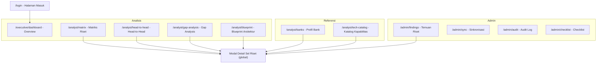
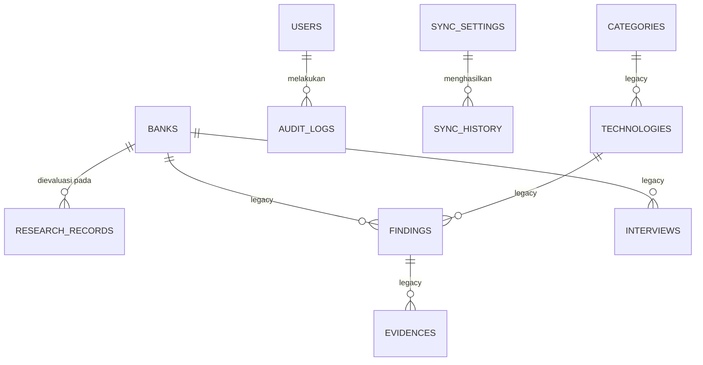
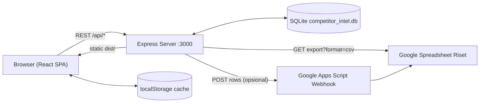

# PRD – Competitor Intelligence: Tech Stack Bank BRI vs Himbara & BCA

| Atribut | Nilai |
| --- | --- |
| **Versi dokumen** | 1.0 (As-Built) |
| **Tanggal** | 19 Oktober 2026 |
| **Status** | Final untuk review – mendeskripsikan produk yang **sudah terbangun** |
| **Menggantikan** | `PRD – Competitor Intelligence Tech Stack Bank BRI vs Himbara.md` (Draft v0.1, 13 Okt 2026) |
| **Dokumen terkait** | `README.md`, `REKOMENDASI_IMPROVEMENT_DAN_ROADMAP_FITUR.md` |
| **Repositori** | `competitor-intelligence-bri` (v1.0.0) |

> **Catatan pembaca:** Dokumen ini disusun dengan membedah kode sumber aplikasi (frontend React, backend Express, skema SQLite, dan dataset riset). Bagian 18 merangkum perbedaan antara rencana Draft v0.1 dan apa yang benar-benar terimplementasi, sedangkan Bagian 17 berisi *known issues* yang ditemukan saat audit kode.

---

## Daftar Isi

1. [Ringkasan Produk](#1-ringkasan-produk)
2. [Latar Belakang & Masalah](#2-latar-belakang--masalah)
3. [Tujuan & Non-Tujuan](#3-tujuan--non-tujuan)
4. [Target Pengguna & Persona](#4-target-pengguna--persona)
5. [Cakupan & Taksonomi Data](#5-cakupan--taksonomi-data)
6. [Model Status Verifikasi & Snapshot Data](#6-model-status-verifikasi--snapshot-data)
7. [Arsitektur Informasi & Navigasi](#7-arsitektur-informasi--navigasi)
8. [Kebutuhan Fungsional & Penjelasan Detail Seluruh Fitur](#8-kebutuhan-fungsional--penjelasan-detail-seluruh-fitur)
9. [Aturan Bisnis & Logika Kalkulasi](#9-aturan-bisnis--logika-kalkulasi)
10. [User Stories & Acceptance Criteria](#10-user-stories--acceptance-criteria)
11. [Model Data](#11-model-data)
12. [Spesifikasi API](#12-spesifikasi-api)
13. [Arsitektur Teknis & Deployment](#13-arsitektur-teknis--deployment)
14. [Kebutuhan Non-Fungsional](#14-kebutuhan-non-fungsional)
15. [Pertimbangan Legal, Etika & Privasi](#15-pertimbangan-legal-etika--privasi)
16. [Metrik Keberhasilan](#16-metrik-keberhasilan)
17. [Known Issues & Technical Debt](#17-known-issues--technical-debt)
18. [Traceability: Draft v0.1 vs As-Built](#18-traceability-draft-v01-vs-as-built)
19. [Roadmap Lanjutan](#19-roadmap-lanjutan)
20. [Risiko & Mitigasi](#20-risiko--mitigasi)
21. [Keputusan & Pertanyaan Terbuka](#21-keputusan--pertanyaan-terbuka)
22. [Lampiran: Glosarium](#22-lampiran-glosarium)

---

## 1. Ringkasan Produk

**Competitor Intel** adalah aplikasi web *evidence-based competitor intelligence* yang membandingkan **tech stack Bank BRI** terhadap **4 bank Himbara (Mandiri, BNI, BTN, BSI) dan BCA**. Data riset disusun sebagai matriks **408 kapabilitas × 6 bank = 2.448 sel evaluasi**, dikelompokkan ke dalam **4 pilar workshop (WS1–WS4)**, **13 domain arsitektur**, dan **9 kategori**.

Setiap sel berisi: *merk/stack* yang digunakan bank, *link/sumber bukti*, *PIC* pencatat, dan **status verifikasi** (`Terverifikasi` / `Inferensi` / `Belum`).

**Value proposition:**
> Satu tempat terpusat untuk memetakan, membandingkan, dan mempresentasikan lanskap teknologi BRI vs kompetitor secara terstruktur, dapat ditelusuri ke sumber, dan siap dipakai di ruang workshop.

**Konteks penggunaan:** dibangun oleh tim konsultan sebagai alat bantu **workshop arsitektur teknologi bersama BRI**. Sumber kebenaran data riset (*source of truth*) adalah **Google Spreadsheet riset tim**, yang ditarik ke database aplikasi melalui fitur sinkronisasi.

---

## 2. Latar Belakang & Masalah

| # | Masalah | Dampak |
| --- | --- | --- |
| 1 | Informasi tech stack bank tersebar (laporan tahunan, siaran pers, studi kasus vendor, lowongan kerja, wawancara). | Benchmarking lambat & tidak konsisten. |
| 2 | Riset dikerjakan banyak PIC di spreadsheet yang panjang (±2.400 baris). | Sulit dibaca, sulit difilter, sulit dipresentasikan. |
| 3 | Tidak ada cara cepat menjawab *"Di mana BRI tertinggal?"*, *"Apa yang hanya dimiliki BRI?"*, *"Apa standar industri?"*. | Insight strategis tidak muncul dari data mentah. |
| 4 | Klaim teknologi harus bisa diaudit sumbernya saat ditanya peserta workshop. | Risiko kredibilitas konsultan. |

---

## 3. Tujuan & Non-Tujuan

### 3.1 Tujuan Produk

| ID | Tujuan | Status as-built |
| --- | --- | --- |
| G1 | Menyajikan perbandingan 408 kapabilitas × 6 bank yang terkelompok per workshop/domain/kategori. | ✅ Tercapai |
| G2 | Setiap sel punya status verifikasi, link sumber, dan PIC. | ✅ Tercapai (sumber berupa teks/URL bebas) |
| G3 | Insight otomatis: **gap** BRI, **keunggulan eksklusif** BRI, **standar paritas** industri. | ✅ Tercapai |
| G4 | Perbandingan langsung dua bank (head-to-head) dan visual blueprint arsitektur. | ✅ Tercapai |
| G5 | Data bisa diperbarui dari Google Sheets & dicatat di audit log. | ✅ Tercapai (pull/push manual) |
| G6 | Siap dipresentasikan langsung dari web saat workshop. | ⚠️ Parsial (Mode Presentasi khusus belum ada) |

### 3.2 Non-Tujuan

- Tidak melakukan scanning/penetrasi atau mengakses sistem internal bank.
- Tidak memuat detail celah keamanan yang dapat dieksploitasi (versi spesifik, endpoint, konfigurasi).
- Bukan alat penilaian kinerja bisnis/finansial bank.
- Tidak mencakup bank di luar 6 bank benchmark (bank digital, bank asing) pada v1.0.
- Tidak menyediakan skor kematangan numerik per domain (dipertimbangkan di roadmap).

---

## 4. Target Pengguna & Persona

| Persona | Peran | Kebutuhan utama | Modul yang paling dipakai |
| --- | --- | --- | --- |
| **Konsultan / Admin Data** | Mengelola riset, sinkronisasi, presentasi | Input & koreksi data cepat, sync dengan Sheet, audit | Admin (Temuan, Sinkronisasi, Audit, Checklist) |
| **Tech/Research Analyst (PIC)** | Mengisi temuan per bank | Mencari kapabilitas, mengisi merk + bukti | Matriks Riset, Detail Sel |
| **Enterprise Architect BRI** | Peserta workshop | Melihat stack kompetitor per layer arsitektur | Blueprint, Head-to-Head |
| **Strategy / Innovation BRI** | Peserta workshop | Melihat gap & peluang untuk roadmap | Overview, Gap Analysis |
| **Eksekutif / Direksi BRI** | Audiens presentasi | Ringkasan cepat, angka kunci | Overview, Profil Bank |

> Pada versi as-built, **semua akun memiliki role `Admin`** (akses penuh). Lihat Bagian 17 untuk implikasinya.

---

## 5. Cakupan & Taksonomi Data

### 5.1 Bank

| Kode | Nama | Peran | Catatan profil |
| --- | --- | --- | --- |
| **BRI** | Bank Rakyat Indonesia | **Fokus utama** (ditandai badge "Fokus") | Pemimpin segmen mikro & ultra-mikro |
| Mandiri | Bank Mandiri | Pembanding | Ekosistem wholesale & corporate |
| BCA | Bank Central Asia | Pembanding (non-Himbara) | Efisiensi transaksi & digital ritel |
| BNI | Bank Negara Indonesia | Pembanding | Global transactional & consumer |
| BTN | Bank Tabungan Negara | Pembanding | Spesialis KPR & perumahan |
| BSI | Bank Syariah Indonesia | Pembanding | Bank syariah terbesar |

Setiap bank memiliki profil: nama, singkatan, deskripsi, logo, daftar **produk digital** (mis. BRImo, Livin', wondr, bale, BYOND), dan warna identitas.

### 5.2 Pilar Workshop (WS)

| Kode | Nama Pilar | Jumlah kapabilitas | Domain |
| --- | --- | --- | --- |
| **WS1** | Core & Digital Banking | 124 | Core Banking System (CBS), Mobile Banking, Internet Banking, Digital Banking |
| **WS2** | EDW, MDM & BI Analytics | 90 | Enterprise Data Warehouse (EDW), Master Data Management (MDM), Business Intelligence (BI) |
| **WS3** | Cloud, Infra & ITSM/Observability | 132 | Cloud Technology, Infrastructure, Network, IT Support (ITSM) |
| **WS4** | Big Data, AI & ML | 62 | Big Data Analytics, AI Technology |
| | **Total** | **408** | **13 domain** |

### 5.3 Domain (13)

| Domain | WS | Kapabilitas |
| --- | --- | --- |
| Core Banking System (CBS) | WS1 | 32 |
| Mobile Banking | WS1 | 31 |
| Internet Banking | WS1 | 31 |
| Digital Banking | WS1 | 30 |
| Enterprise Data Warehouse (EDW) | WS2 | 30 |
| Master Data Management (MDM) | WS2 | 30 |
| Business Intelligence (BI) | WS2 | 30 |
| Cloud Technology | WS3 | 30 |
| Infrastructure | WS3 | 31 |
| Network | WS3 | 34 |
| IT Support (ITSM) | WS3 | 37 |
| Big Data Analytics | WS4 | 31 |
| AI Technology | WS4 | 31 |

### 5.4 Kategori (9)

| Kategori | Jumlah | Kategori | Jumlah |
| --- | --- | --- | --- |
| Software/Sistem | 205 | Standar/Protokol | 28 |
| Keamanan | 46 | Metrik/Benchmark | 18 |
| Arsitektur | 35 | Layanan/Komersial | 14 |
| Tool | 28 | Regulasi | 6 |
| Hardware | 28 | | |

> Domain dan kategori bersifat **data-driven**: daftar filter dibangun otomatis dari data, sehingga domain/kategori baru dari Google Sheet langsung muncul di UI. Sebaliknya, **daftar 6 bank dan 4 workshop masih hardcoded** di kode (lihat Bagian 17).

---

## 6. Model Status Verifikasi & Snapshot Data

### 6.1 Definisi Status

| Status | Label UI | Definisi | Warna |
| --- | --- | --- | --- |
| `Terverifikasi` | ✓ Verified | Dibuktikan oleh sumber resmi/publik: laporan tahunan, siaran pers, studi kasus vendor, conference talk, atau dokumen resmi. | Hijau (`ok`) |
| `Inferensi` | ⚠ Inferensi | Indikasi kuat dari sinyal publik/korelasi industri (artikel, lowongan kerja, pola teknis), belum dikonfirmasi resmi. | Kuning (`warn`) |
| `Belum` | – Belum | Belum ada data/rujukan publik yang tercatat. | Abu-abu / merah muda (admin) |

> **Penting:** Seluruh kalkulasi insight (gap, moat, paritas) hanya menghitung status **`Terverifikasi`**. Status `Inferensi` diperlakukan sama dengan "belum terbukti" dalam logika gap.

### 6.2 Snapshot Data (per 19 Okt 2026)

| Bank | Terverifikasi | Inferensi | Belum | % Terverifikasi |
| --- | --- | --- | --- | --- |
| **BRI** | **52** | 8 | 348 | **12,7%** |
| Mandiri | 41 | 6 | 361 | 10,0% |
| BNI | 41 | 5 | 362 | 10,0% |
| BCA | 35 | 4 | 369 | 8,6% |
| BSI | 23 | 5 | 380 | 5,6% |
| BTN | 16 | 2 | 390 | 3,9% |
| **Total** | **208** | **30** | **2.210** | **8,5%** |

**Insight dari snapshot:**
- ~90% sel masih berstatus `Belum` → angka gap/moat saat ini merepresentasikan **cakupan riset**, belum tentu kondisi riil bank. Ini wajib disampaikan sebagai *disclaimer* saat workshop.
- 2.122 dari 2.448 sel (~87%) masih memakai PIC default (`Mrs Utami`), menandakan banyak sel belum disentuh PIC riset spesifik.

---

## 7. Arsitektur Informasi & Navigasi

### 7.1 Sitemap & Routing

Aplikasi berupa SPA dengan routing berbasis `history.pushState` (tanpa React Router).



| Grup Sidebar | Menu | Route | Badge hitungan |
| --- | --- | --- | --- |
| Analisis | Overview | `/executive/dashboard` | – |
| | Matriks riset | `/analyst/matrix` | jumlah kapabilitas |
| | Head-to-head | `/analyst/head-to-head` | – |
| | Gap analysis | `/analyst/gap-analysis` | – |
| | Blueprint arsitektur | `/analyst/blueprint` | – |
| Referensi | Profil bank | `/analyst/banks` | – |
| | Katalog kapabilitas | `/analyst/tech-catalog` | – |
| Admin | Temuan riset | `/admin/findings` | jumlah kapabilitas |
| | Sinkronisasi | `/admin/sync` | – |
| | Audit log | `/admin/audit` | jumlah log |
| | Checklist | `/admin/checklist` | – |

### 7.2 Elemen Global (Shell Aplikasi)

| Elemen | Fungsi |
| --- | --- |
| **Sidebar** (lebar 240px, collapsible) | Navigasi 3 grup, brand "Competitor Intel – BRI vs Himbara & BCA", indikator status DB (*Database tersambung* / *Mode lokal*), tombol **Sync**, menu user (ganti tema, keluar). |
| **Topbar** (sticky) | Toggle sidebar, breadcrumb `Grup › Menu`, menu **Export** (Matriks riset CSV, Backup lengkap JSON), toggle tema. |
| **Shortcut keyboard** | `Ctrl/Cmd + B` → buka/tutup sidebar (tidak aktif saat mengetik di input). |
| **Mobile drawer** | Sidebar menjadi drawer overlay di layar < `lg`. |
| **Tema** | Light/Dark, mengikuti preferensi OS saat pertama kali, disimpan di `localStorage`. |
| **Modal global** | *Research Detail Modal* dan *Google Sheets Sync Modal* dapat dibuka dari halaman mana pun. |

---

## 8. Kebutuhan Fungsional & Penjelasan Detail Seluruh Fitur

Notasi prioritas pengembangan: **P0** = inti & wajib untuk workshop; **P1** = penting; **P2** = pendukung.

Seluruh fitur dalam aplikasi web dikelompokkan ke dalam 4 modul utama:
1. **Shell Aplikasi & Navigasi Global** (Login, Sesi, Sidebar, Topbar, Dark Mode)
2. **Modul Analisis Strategis** (Overview, Matriks Riset, Modal Detail Sel, Head-to-Head, Gap Analysis, Blueprint Arsitektur)
3. **Modul Referensi** (Profil Bank, Katalog Kapabilitas)
4. **Modul Admin CMS & Tata Kelola Data** (Kelola Temuan, Google Sheets Sync, Backup/Restore, Audit Trail, Checklist)

---

### 8.1 Shell Aplikasi & Navigasi Global

#### F0. Autentikasi, Keamanan Sesi & Fallback Offline — P0
* **Deskripsi & Nilai Penggunaan:** Gerbang akses pengguna sebelum masuk ke aplikasi untuk memastikan data intelijen perbankan hanya diakses oleh pihak yang berwenang.
* **Komponen & Kemampuan Utama:**
  * **Tata Letak 2 Kolom:** Di layar desktop, sisi kiri menampilkan panel konteks informatif (headline *"Benchmark tech stack BRI terhadap Himbara & BCA"*, 3 kartu statistik kunci `408 Kapabilitas / 13 Domain / 6 Bank`, dan deretan logo bank pembanding). Sisi kanan memuat kartu formulir login yang bersih.
  * **Formulir Kredensial:** Input email (case-insensitive & otomatis di-*trim*) dan kata sandi dengan tombol toggle tampilkan/sembunyikan kata sandi (ikon mata).
  * **Validasi & Penanganan Kesalahan:** Menampilkan kotak peringatan merah inline (*role="alert"*) bila kombinasi email atau kata sandi tidak cocok.
  * **Ketahanan Sesi (Session Persistence):** Status login disimpan di `localStorage`. Pengguna yang sudah masuk tidak akan ter-logout saat melakukan penyegaran halaman (*browser refresh*).
  * **Proteksi Rute (Route Guard):** Pengguna tanpa sesi otomatis dialihkan ke `/login`. Pengguna yang sudah memiliki sesi dialihkan langsung ke halaman utama.
  * **Mode Offline Fallback:** Bila server backend Express/SQLite tidak aktif atau jaringan terputus, login tetap dapat memverifikasi kredensial lokal darurat (`admin@intel.com`, `analyst@intel.com`, `executive@intel.com`) agar pemaparan di ruang rapat tetap dapat berlangsung.
  * **Pencatatan Audit:** Setiap proses masuk yang berhasil otomatis dicatat ke dalam audit log server dengan aksi `LOGIN`.

#### F0.1 Sidebar Navigasi Lipat (Collapsible Sidebar) — P1
* **Deskripsi & Nilai Penggunaan:** Panel navigasi di sisi kiri layar yang memandu alur kerja pengguna secara terstruktur.
* **Komponen & Kemampuan Utama:**
  * **Pengelompokan Menu Berjenjang:**
    * *Grup Analisis:* Overview, Matriks riset, Head-to-head, Gap analysis, Blueprint arsitektur.
    * *Grup Referensi:* Profil bank, Katalog kapabilitas.
    * *Grup Admin:* Temuan riset, Sinkronisasi, Audit log, Checklist.
  * **Badge Hitungan Data (Live Count):** Menampilkan badge numerik jumlah data langsung pada menu *Matriks riset* (408), *Temuan riset* (408), dan *Audit log* (jumlah log).
  * **Dukungan Shortcut Keyboard:** Tombol pintas **`Ctrl + B`** (atau `Cmd + B` pada macOS) untuk membuka atau melipat sidebar seketika, memberi keleluasaan pandang saat meneliti tabel data lebar. Shortcut otomatis dinonaktifkan saat kursor berada di dalam input teks.
  * **Indikator Kesehatan Basis Data:** Menampilkan status konektivitas *Database tersambung* (hijau) atau *Mode lokal* (kuning) serta tombol cepat pemanggil modal sinkronisasi Google Sheets.
  * **Profil Pengguna & Menu Sesi:** Menampilkan inisial avatar pengguna, nama lengkap, email, toggle tema visual, dan tombol *Keluar (Logout)*.
  * **Desain Responsif:** Pada layar smartphone/tablet (< 1024px), sidebar otomatis bertransformasi menjadi laci geser (*mobile drawer overlay*).

#### F0.2 Bar Navigasi Atas (Topbar) & Tema Gelap/Terang (Dark/Light Mode) — P1
* **Deskripsi & Nilai Penggunaan:** Header tetap (*sticky*) di bagian atas layar untuk pemantauan posisi dan utilitas cepat.
* **Komponen & Kemampuan Utama:**
  * **Breadcrumb Dinamis:** Menampilkan navigasi jejak remah roti secara otomatis (contoh: `Analisis › Matriks riset`) sesuai rute aktif.
  * **Tombol Tema Gelap/Terang:** Beralih instan antara mode siang (*Light Mode*) bernuansa fintech korporat dan mode malam (*Dark Mode*) berlatar slate pekat yang elegan. Tema otomatis mengikuti preferensi OS saat pertama kali dibuka dan disimpan permanen di penyimpanan browser.
  * **Menu Ekspor Terpusat:** Tombol dropdown *Export* yang menyediakan akses instan untuk mengunduh berkas CSV matriks 408 kapabilitas maupun berkas JSON cadangan penuh.

#### F0.3 Kontrol Akses Berbasis Peran (RBAC Guard) & Layar 403 Forbidden — P1
* **Deskripsi & Nilai Penggunaan:** Mekanisme pengamanan navigasi internal yang memvalidasi tingkat wewenang pengguna sebelum menampilkan modul tertentu guna mencegah akses yang tidak sah.
* **Komponen & Kemampuan Utama:**
  * **Pemeriksaan Otorisasi Rute:** Setiap perpindahan halaman memeriksa peran pengguna aktif (`Admin`, `Analyst`, `Executive`) terhadap batas izin modul yang dituju.
  * **Layar 403 Forbidden (`ForbiddenView`):** Jika akun tanpa wewenang mencoba mengakses rute terproteksi (misalnya analis biasa mengakses menu administrasi kritis), sistem merender tampilan peringatan 403 khusus yang memuat:
    * Ikon perisai keamanan merah mencolok dan badge *"403 - Akses Dibatasi"*.
    * Rincian identitas akun: nama pengguna aktif, peran yang sedang diemban, dan peran minimum yang disyaratkan oleh sistem.
    * Tombol pemulihan satu-klik *"Kembali ke Portal Anda"* yang secara otomatis mengarahkan pengguna kembali ke rute beranda yang sah sesuai perannya (`getRoleHomeUrl`).

#### F0.4 Dialog Konfirmasi Bertingkat Tindakan Kritis (Danger Zone Safeguards) — P1
* **Deskripsi & Nilai Penggunaan:** Pengaman berlapis (*safety modal dialog*) untuk mencegah eksekusi aksi destruktif atau permanen yang tidak disengaja oleh administrator.
* **Komponen & Kemampuan Utama:**
  * **Pencegahan Penghapusan Data:** Menahan eksekusi saat pengguna menekan tombol hapus kapabilitas master di CMS atau menginisiasi pemulihan darurat (*Reset Database ke Initial Seed*).
  * **Tampilan Modal Konfirmasi Interaktif:** Memunculkan dialog modal beraksen merah peringatan (*danger state*) yang menjelaskan konsekuensi data yang akan hilang secara eksplisit, mewajibkan konfirmasi sadar, dan menyediakan tombol *Batal* yang langsung menutup dialog tanpa mengubah kondisi basis data.

#### F0.5 Mekanisme Tautan Silang Antar-Modul (Cross-Module Deep-Linking) — P1
* **Deskripsi & Nilai Penggunaan:** Integrasi alur kerja tanpa hambatan (*frictionless UX*) yang memungkinkan analis dan eksekutif berpindah konteks antar-modul secara instan tanpa perlu mencari ulang dari menu sidebar.
* **Komponen & Kemampuan Utama:**
  * **Tautan Kartu Ringkasan Overview:**
    * Mengklik kartu *Total Kapabilitas* di Dashboard Eksekutif langsung membuka Matriks Riset (`/analyst/matrix`).
    * Mengklik kartu *Celah Arsitektur (Gaps)* langsung mengarahkan ke tab *Gaps* di modul Gap Analysis (`/analyst/gap-analysis`).
    * Mengklik kartu *Keunggulan Eksklusif (Moats)* langsung mengarahkan ke tab *Moats* di Gap Analysis.
  * **Leaderboard ke Profil Bank:** Mengklik tombol *Detail →* di deretan peringkat 6 bank langsung memuat profil perseroan bank tersebut di `/analyst/banks`.
  * **Blueprint ke Editor Sel Riset:** Mengklik tombol *Edit Sel Riset* di dalam modal inspeksi topologi arsitektur langsung memunculkan *Research Detail Modal* untuk memperbarui data bank bersangkutan.

---

### 8.2 Modul Analisis Strategis (Cockpit Eksekutif & Arsitek)

#### F1. Executive Overview (Dashboard Eksekutif) — P0
* **Rute:** `/executive/dashboard`
* **Deskripsi & Nilai Penggunaan:** Dasbor strategis satu layar yang dirancang untuk pimpinan, Direksi, dan Kepala Divisi IT dalam membaca peta persaingan teknologi BRI secara instan tanpa tenggelam dalam ribuan baris teknis.
* **Komponen & Kemampuan Utama:**
  * **4 Kartu KPI Ringkasan Eksekutif:**
    1. *Total Kapabilitas:* Menampilkan angka 408 kapabilitas di 13 domain arsitektur (klik untuk menuju Matriks Riset).
    2. *Maturitas Terverifikasi BRI:* Persentase kapabilitas BRI yang terverifikasi resmi beserta perbandingannya terhadap rata-rata industri.
    3. *Celah Arsitektur (Gaps):* Menghitung total kapabilitas yang sudah diadopsi kompetitor tetapi belum terbukti di BRI (klik untuk menuju Gap Analysis).
    4. *Keunggulan Eksklusif BRI (Moats):* Jumlah kapabilitas yang terverifikasi hanya di BRI dan belum ada di kompetitor (klik untuk membuka tab Moats).
  * **Matriks Kematangan 13 Domain × 6 Bank (Heatmap Coverage):**
    * Tabel sebaran adopsi teknologi per domain arsitektur untuk ke-6 bank (BRI, Mandiri, BCA, BNI, BTN, BSI).
    * Setiap sel memperlihatkan rasio verifikasi (contoh: `18/32`).
    * Pewarnaan sel dinamis: **Hijau** (adopsi tinggi ≥ 50%), **Biru** (sedang ≥ 25%), **Kuning** (terdapat adopsi > 0%), dan **Abu-abu** (belum terbukti 0%). Kolom Bank BRI diberi aksen khusus sebagai fokus pembanding.
    * Fitur filter nama domain dan segmented control pilar workshop (Semua, WS1, WS2, WS3, WS4).
  * **Peringkat Cakupan Verifikasi 6 Bank (Leaderboard):**
    * Mengurutkan bank dari yang memiliki jumlah verifikasi teknologi tertinggi ke terendah.
    * Bar kemajuan visual (*stacked meter bar*) yang memisahkan proporsi data *Terverifikasi* (hijau), *Inferensi* (kuning), dan *Belum Terdata* (abu-abu).
    * Tombol *Detail →* yang langsung mengarahkan pengguna ke halaman profil bank terkait.
  * **Prioritas Telaah Strategis (Strategic Triage):**
    * Segmented control 3 tab: **Gaps** (Celah), **Moats** (Keunggulan), dan **Standar** (Konsensus Bersama).
    * Menampilkan 6 kartu temuan prioritas teratas dengan pilar workshop, domain, dan kategori.
    * Mengklik kartu akan memunculkan modal audit rincian bukti sel tersebut.
  * **4 Pilar Workshop Arsitektur:** Kartu gambaran 4 sesi workshop perbankan (Core Banking, EDW/BI, Cloud/Infra, Big Data/AI) beserta jumlah kapabilitas dan persentase volumenya.

#### F2. Matriks Riset Kapabilitas (Fitur Inti / Matrix View) — P0
* **Rute:** `/analyst/matrix`
* **Deskripsi & Nilai Penggunaan:** Lembar kerja data utama yang membandingkan 408 kapabilitas terhadap 6 bank sekaligus (total 2.448 sel evaluasi). Menjadi acuan kerja harian tim konsultan dan analis riset.
* **Komponen & Kemampuan Utama:**
  * **Penonjolan Kolom BRI:** Kolom Bank BRI diberi penanda latar visual khusus dan badge *"Fokus"* agar mata audiens selalu berpusat pada bank target.
  * **Kartu Sel Komparasi Interaktif:**
    * Menampilkan nama merk/solusi yang digunakan bank (maksimal 2 baris teks).
    * Indikator status berupa titik dot berwarna: Hijau (*Terverifikasi*), Kuning (*Inferensi*), atau Abu-abu (*Belum*).
    * Nama PIC penguji data.
    * Ikon tautan eksternal bila sel memiliki rujukan URL web.
  * **Klik Sel untuk Audit & Edit:** Klik pada sel mana saja membuka *Modal Detail Sel Riset* untuk melihat bukti lengkap atau mengubah data.
  * **Filter Berlapis Komprehensif (Multi-Level Filtering):**
    * *Workshop:* Semua, WS1, WS2, WS3, WS4.
    * *Domain:* Dropdown seluruh 13 domain arsitektur.
    * *Kategori:* Dropdown 9 kategori sistem beserta jumlah kemunculannya.
    * *Status:* Memfilter baris yang minimal salah satu banknya berstatus *Terverifikasi*, *Inferensi*, atau *Belum*.
    * *Pencarian Teks Bebas:* Mesin pencari instan yang mencocokkan nama kapabilitas, domain, kategori, merk solusi, maupun isi tautan sumber.
  * **Indikator Filter Aktif & Reset 1-Klik:** Badge pengingat saat filter menyaring data beserta tombol *Reset filter* untuk kembali ke tampilan penuh.
  * **Paginasi Fleksibel:** Opsi tampilan 25, 50 (bawaan), 100, atau *Semua Baris* (menampilkan 408 baris sekaligus tanpa terpotong).
  * **Ekspor CSV Matriks (Format Lebar):** Menghasilkan file CSV terstruktur rapi (1 baris per kapabilitas dengan 4 kolom untuk tiap bank: Merk, Status, Link, PIC) yang dilengkapi UTF-8 BOM agar terbaca sempurna di Microsoft Excel.

#### F3. Modal Detail Sel Riset & Quick Editor (Audit Bukti Sel) — P0
* **Deskripsi & Nilai Penggunaan:** Jendela pop-up serbaguna yang menjadi jantung pembuktian (*auditability*) data aplikasi, dapat dipanggil dari modul mana pun saat mengklik nama teknologi atau sel bank.
* **Komponen & Kemampuan Utama:**
  * **Navigasi Cepat 6 Bank (Bank Tab Switcher):** Di bagian atas modal, tersedia tab untuk ke-6 bank (BRI, Mandiri, BCA, BNI, BTN, BSI) lengkap dengan dot status verifikasi. Pengguna dapat berpindah melihat data bank lain pada kapabilitas yang sama tanpa menutup modal.
  * **Tampilan Mode Baca (Audit View):**
    * Menampilkan nama lengkap bank dan penanda *"Target Analisis"* pada BRI.
    * Badge status verifikasi resmi bersertifikat warna.
    * Kotak teks merk/stack solusi yang digunakan.
    * Kotak teks bukti kutipan rujukan publik.
    * Tombol **"Buka Sumber Rujukan Asli"** yang membuka dokumen sumber (laporan tahunan/berita/studi kasus) di tab browser baru jika terdapat tautan URL.
    * Nama PIC analis pencatat data.
  * **Tombol Salin Kutipan Riset (1-Click Citation):** Menyalin teks sitasi terformat rapi (mencakup Workshop, Domain, Kategori, Kapabilitas, Bank, Merk, Status, Link Bukti, dan PIC) ke clipboard untuk dibagikan ke forum diskusi atau dokumen eksternal.
  * **Formulir Edit Langsung (Inline Quick Editor):** Pengguna dengan hak Admin dapat beralih ke form edit untuk memperbarui:
    * Merk / Stack Name (wajib diisi).
    * Status Verifikasi (pilihan dropdown 3 status).
    * PIC Penguji Data.
    * Link / Kutipan Sumber Rujukan (textarea multi-baris). URL web pertama di dalam teks link otomatis diekstrak menjadi tautan yang dapat diklik.
  * **Penyimpanan Dua Arah & Audit Trail:** Saat disimpan, data otomatis terupdate di tampilan antarmuka, diperbarui di database SQLite server, dan mencatat riwayat perubahan di audit log.

#### F4. Head-to-Head Comparison (Komparasi 2 Bank) — P0
* **Rute:** `/analyst/head-to-head`
* **Deskripsi & Nilai Penggunaan:** Fasilitas perbandingan langsung antara dua bank pilihan secara berdampingan (secara default membandingkan **Bank BRI vs Bank Mandiri**).
* **Komponen & Kemampuan Utama:**
  * **Dua Panel Pemilih Bank Bebas:** Pengguna dapat memilih kombinasi bank mana pun (misal: BRI vs BCA, atau Mandiri vs BNI). Pilihan bank yang sama di kedua sisi otomatis dinonaktifkan.
  * **Tombol Tukar Posisi (Swap):** Membalik posisi Bank A dan Bank B secara instan dengan satu kali klik.
  * **Ribbon Statistik Komparasi Otomatis (Klik untuk Filter):**
    * *Keunggulan Bank A:* Jumlah teknologi yang hanya terverifikasi di Bank A.
    * *Keunggulan Bank B:* Jumlah teknologi yang hanya terverifikasi di Bank B (merupakan celah bagi Bank A).
    * *Keduanya Terverifikasi:* Jumlah teknologi di mana kedua bank telah mengadopsi solusi terbukti.
  * **Tabel Perbandingan & Kolom Status Paritas:**
    * Kolom Bank A diberi penanda visual aksen.
    * Kolom Bank B sebagai lawan tanding.
    * Kolom Status Paritas Arsitektur:
      * `Paritas Bersama` (Hijau): Kedua bank sama-sama terverifikasi.
      * `Unggul [Bank A]` (Biru): Bank A memimpin adopsi.
      * `Unggul [Bank B]` (Kuning): Bank B memimpin adopsi.
      * `Beda Solusi` (Abu-abu): Kedua bank sama-sama menggunakan sistem tetapi merk vendornya berbeda.
      * `–`: Belum ada data pembuktian di kedua pihak.
  * **Filter Status Komparasi:** Menyaring tabel hanya untuk menampilkan kapabilitas dengan status paritas tertentu (misal: hanya melihat keunggulan lawan).

#### F5. Gap Analysis & Peluang Strategis — P0
* **Rute:** `/analyst/gap-analysis`
* **Deskripsi & Nilai Penggunaan:** Mesin analitik otomatis yang memetakan posisi tawar teknologi Bank BRI terhadap para pesaing guna menghasilkan rekomendasi peta jalan (*roadmap*) teknologi.
* **Komponen & Kemampuan Utama:**
  * **3 Tab Analisis Strategis:**
    1. *Celah untuk BRI (Gaps):* Daftar kapabilitas di mana bank kompetitor (Mandiri, BCA, BNI, BTN, atau BSI) sudah terbukti mengadopsi solusi modern, namun di Bank BRI masih berstatus belum terbukti atau inferensi. Dilengkapi penanda tingkat urgensi (Urgensi Tinggi jika diadopsi ≥ 2 kompetitor).
    2. *Keunggulan Eksklusif BRI (Moats):* Daftar kapabilitas di mana hanya Bank BRI yang terverifikasi mengadopsi solusinya (faktor pembeda bersaing/keunggulan kompetitif).
    3. *Standar Paritas Bersama (Consensus):* Daftar teknologi yang sudah diadopsi secara luas oleh industri perbankan nasional (terverifikasi di BRI dan minimal 2 bank kompetitor).
  * **Daftar Kompetitor Pengadopsi Interaktif:** Pada tab Gaps, kolom kanan menampilkan deretan kartu bank kompetitor yang sudah mengadopsi teknologi tersebut lengkap dengan merk yang mereka gunakan. Mengklik kartu kompetitor akan membuka modal rincian bukti sumber milik kompetitor tersebut.
  * **Filter Khusus Kompetitor:** Pengguna dapat menyaring celah teknologi berdasarkan kompetitor spesifik (misal: *"Tampilkan hanya celah teknologi di mana Bank Mandiri sudah terverifikasi"*).

#### F6. Blueprint Arsitektur (Interactive Topology View) — P1
* **Rute:** `/analyst/blueprint`
* **Deskripsi & Nilai Penggunaan:** Diagram topologi blok arsitektur enterprise perbankan modern yang memvisualisasikan interkoneksi sistem dari saluran nasabah hingga infrastruktur fisik.
* **Struktur 5 Lapisan Arsitektur (Layers):**
  * **Layer 1 (Touchpoint & Digital Channels):** Consumer Mobile SuperApp, Corporate Wholesale & CMS, Open Banking API Gateway (SNAP BI).
  * **Layer 2 (Integration & Middleware Orchestration):** High-Throughput Event Streaming & Pub-Sub (Kafka), Enterprise API Management Platform.
  * **Layer 3 (Core Financial Processing & Operations):** Core Banking System (CBS), ERP & General Ledger Accounting, Enterprise IT Service Management (ITSM).
  * **Layer 4 (Enterprise Data Platform & AI Intelligence):** Enterprise Data Warehouse & Lakehouse, Distributed Big Data Processing Engine, AI/ML Platform & Fraud Analytics, Master Data Management (Customer 360).
  * **Layer 5 (Cloud Foundation, Infrastructure & Security):** Container Platform & Private Cloud PaaS, Enterprise Network & SD-WAN Interconnect.
* **Kemampuan Interaktif:**
  * **Konektor Alur Data (Data Flow Connectors):** Garis indikator antar-lapisan yang memvisualisasikan arah aliran data (misal: *Trafik Pengguna & API Gateway*, *Pesan Asynchronous & Switching*, *Change Data Capture & Sinkronisasi*, *Virtualisasi & Orkestrasi*).
  * **3 Mode Tampilan Visual:**
    1. *Duel Mode:* Membagi setiap kotak blok arsitektur menjadi dua sisi untuk memperbandingkan stack Bank 1 vs Bank 2 secara langsung di dalam diagram.
    2. *Fokus Bank 1:* Menyederhanakan diagram untuk mengevaluasi arsitektur satu bank saja.
    3. *Heatmap Paritas:* Mewarnai setiap blok arsitektur berdasarkan kondisi kesetaraan (Hijau = Setara/Paritas, Biru = Bank 1 Unggul, Kuning = Bank 2 Unggul).
  * **Filter Lapisan (Layer Filter):** Tombol pemfilter cepat untuk menampilkan layer tertentu saja (L1 s/d L5) atau seluruh layer bersamaan.
  * **Modal Inspeksi Blok Arsitektur:** Mengklik salah satu blok diagram membuka lembar inspeksi mendalam yang menampilkan:
    * Fungsi arsitektur sistem.
    * Kapabilitas riset terkait dari dataset 408 kapabilitas.
    * Rangkuman implementasi merk dan status verifikasi di ke-6 bank sekaligus.
    * Tombol pintas untuk membuka editor sel riset terkait.

---

### 8.3 Modul Referensi (Profil & Katalog)

#### F7. Profil Bank & Progres Workshop — P1
* **Rute:** `/analyst/banks`
* **Deskripsi & Nilai Penggunaan:** Pusat informasi terdedikasi untuk membedah profil teknologi masing-masing perseroan bank secara mendalam.
* **Komponen & Kemampuan Utama:**
  * **Tab Pemilih 6 Bank:** Akses cepat ke profil Bank BRI, Bank Mandiri, BCA, BNI, BTN, dan BSI.
  * **Header Profil Resmi Perseroan:** Logo resmi beresolusi tinggi, nama perseroan, deskripsi fokus bisnis perbankan, dan daftar chip **produk digital unggulan** (seperti *BRImo, Pasar.id, Kopra, Livin', wondr, bale, BYOND, myBCA*).
  * **Statistik Cepat Verifikasi:** Kotak hitungan jumlah kapabilitas *Verified*, *Inferensi*, dan *Belum* untuk bank yang sedang dipilih.
  * **4 Kartu Progres Kematangan Workshop:** Meteran kematangan visual di 4 pilar workshop arsitektur yang memperlihatkan persentase kapabilitas yang berhasil diverifikasi pada bank tersebut.
  * **Tabel Portofolio Kapabilitas Bank:** Daftar seluruh sistem yang digunakan bank terpilih lengkap dengan merk, nama PIC reviewer, status verifikasi, dan tautan rujukan.

#### F8. Katalog Kapabilitas Teknologi — P2
* **Rute:** `/analyst/tech-catalog`
* **Deskripsi & Nilai Penggunaan:** Menampilkan seluruh 408 kapabilitas riset dalam bentuk kartu-kartu visual (*card grid view*), sangat memudahkan penjelajahan cepat (*browsing*) kapabilitas perbankan.
* **Komponen & Kemampuan Utama:**
  * **Tampilan Grid Kartu Responsif:** Menyusun data dalam format 1 kolom (mobile), 2 kolom (tablet), atau 3 kolom (desktop), sebanyak 30 kartu per halaman.
  * **Mini-Grid 6 Bank pada Tiap Kartu:** Setiap kartu kapabilitas memuat kotak mini untuk ke-6 bank yang diberi kode warna status (*Hijau* = Terverifikasi, *Kuning* = Inferensi, *Abu-abu* = Belum) dan nama merk yang digunakan.
  * **Filter Adopsi Bank:** Kemampuan unik untuk menyaring kartu: *"Tampilkan hanya kapabilitas yang sudah diadopsi oleh Bank X"*.

---

### 8.4 Modul Admin CMS & Tata Kelola Data (Governance)

#### F9. Kelola Temuan Riset (Admin Research Matrix Master) — P0
* **Rute:** `/admin/findings`
* **Deskripsi & Nilai Penggunaan:** Panel kendali basis data master tempat administrator dan analis mengelola entri 408 kapabilitas riset secara terstruktur.
* **Komponen & Kemampuan Utama:**
  * **Tabel Master Berwarna Penuh (Full Color Badges):** Seluruh sel evaluasi 6 bank diwarnai penuh (hijau untuk terverifikasi, kuning untuk inferensi, dan merah muda untuk belum terdata) sehingga admin dapat memindai kelengkapan riset dalam hitungan detik.
  * **Formulir Input Temuan Baru (Tambah Kapabilitas):**
    * Modal input untuk mendaftarkan kapabilitas arsitektur baru.
    * Pengguna mengisi nama kapabilitas (wajib), pilar workshop, domain, kategori, serta evaluasi awal untuk masing-masing dari 6 bank.
    * Nomor urut kapabilitas (`no`) otomatis dihitung dari nomor tertinggi + 1, dan sistem otomatis membuatkan 6 record bank terkait ke database SQLite.
  * **Formulir Edit Baris Master (Multi-Bank Edit):** Modal komprehensif untuk mengubah metadata kapabilitas sekaligus memperbarui merk, status, link, dan PIC untuk ke-6 bank dalam satu layar kerja yang sama.
  * **Fitur Hapus Kapabilitas Aman:** Menghapus satu kapabilitas beserta seluruh 6 data evaluasi banknya dengan konfirmasi dialog pengamanan bertingkat.

#### F10. Pusat Sinkronisasi Google Sheets (Google Sheets Live Sync Center) — P0
* **Rute:** `/admin/sync` atau klik tombol **Sync** di sidebar/topbar.
* **Deskripsi & Nilai Penggunaan:** Fitur integrasi langsung ke Google Spreadsheet riset publik milik tim konsultan untuk memastikan keselarasan data antara lembar kerja riset dan aplikasi web secara dua arah.
* **Fitur & Tab di dalamnya:**
  * **Tarik Data (Pull Sync):**
    * Mengunduh data CSV publik dari URL Google Spreadsheet yang ditentukan.
    * Menganalisis dan mengekstrak 408 baris kapabilitas × 6 bank secara otomatis dengan algoritma parser RFC 4180 (kebal terhadap enter/baris baru di dalam tanda kutip).
    * Memperbarui seluruh isi tabel `research_records` SQLite secara aman di dalam satu transaksi database tunggal (*ACID transaction*).
  * **Kirim Data (Push Sync via Webhook):**
    * Mengalirkan data perubahan dari aplikasi web kembali ke Google Spreadsheet menggunakan Webhook Google Apps Script.
  * **Salin Tabel 1-Klik (Clipboard TSV Export):**
    * Alternatif praktis bila webhook belum dipasang: tombol yang langsung memformat dan menyalin seluruh 2.448 baris data riset ke clipboard dalam format TSV (*Tab-Separated Values*). Admin cukup membuka Google Sheet dan menekan **`Ctrl + V`** di sel A1.
  * **Tab Riwayat Sinkronisasi (Sync History):**
    * Menampilkan tabel catatan 50 aktivitas sinkronisasi terakhir (tipe aksi PULL/PUSH, URL target, status berhasil/gagal, jumlah baris terekstrak, dan pesan rangkuman).
  * **Tab Skrip Webhook Siap Pakai:**
    * Menyediakan skrip Google Apps Script (`doPost`/`doGet`) lengkap dengan panduan pemasangan di Google Sheets untuk mengaktifkan fitur Push otomatis.
  * **Unduh Berkas CSV Format Google Sheet:**
    * Menyediakan endpoint pengunduhan file CSV terstruktur yang siap diimpor langsung melalui menu *File > Import* di Google Sheets.

#### F11. Pencadangan, Pemulihan Basis Data & Ekspor (Backup & Restore) — P1
* **Fungsi:** Menjamin keamanan dan ketersediaan data dari potensi kehilangan akibat kerusakan sistem atau kesalahan input manual.
* **Komponen & Kemampuan Utama:**
  * **Ekspor Cadangan JSON Lengkap (Backup JSON):** Mengunduh arsip seluruh basis data aplikasi ke dalam berkas `.json` bertanggal.
  * **Impor Cadangan JSON (Restore JSON):** Mengunggah kembali berkas cadangan JSON untuk memulihkan kondisi data.
  * **Ekspor Matriks CSV (Format Excel):** Mengunduh data matriks kapabilitas dalam format spreadsheet CSV.
  * **Zona Berbahaya (Reset Basis Data):** Fitur pemulihan darurat dengan konfirmasi pengamanan untuk mengosongkan dan mengatur ulang isi basis data kembali ke bibit data bawaan (*initial seed*).

#### F12. Audit Trail Log (Pelacakan Jejak Perubahan Sistem) — P1
* **Rute:** `/admin/audit`
* **Deskripsi & Nilai Penggunaan:** Memenuhi standar kepatuhan tata kelola TI perbankan (*IT Governance, Compliance & Auditability*) dengan mencatat setiap aksi modifikasi data secara transparan.
* **Komponen & Kemampuan Utama:**
  * **Pencatatan 100 Aktivitas Kronologis Terbaru:** Setiap penambahan, pembaruan, penghapusan, sinkronisasi, dan login dicatat bersama stempel waktu (*timestamp*) presisi.
  * **Pembedaan Warna Tipe Aksi:** `CREATE` (biru), `UPDATE` (kuning), `DELETE` (merah), `SYNC` (hijau), dan `LOGIN` (slate).
  * **Penyaringan Aksi Cepat:** Tombol filter untuk menampilkan hanya aksi tertentu (Semua, CREATE, UPDATE, DELETE).
  * **Pencarian Teks Log:** Mencari riwayat audit berdasarkan nama pengguna, nama sistem/kapabilitas, maupun rincian keterangan aksi.

#### F13. Checklist Kesiapan Workshop — P2
* **Rute:** `/admin/checklist`
* **Deskripsi & Nilai Penggunaan:** Lembar kendali mutu (*quality gate*) bagi tim konsultan sebelum mempresentasikan web ke hadapan Dewan Direksi dan arsitek Bank BRI.
* **Pilar Pemeriksaan Kesiapan:**
  1. *Validitas & Tautan Bukti Riset:* Memastikan kelengkapan bukti publik dan tautan pada seluruh sel evaluasi.
  2. *Standarisasi 4 Workshop & 13 Domain:* Memastikan konsistensi pembagian kapabilitas di WS1 s/d WS4.
  3. *Tata Kelola & Kepatuhan UU PDP:* Memverifikasi bahwa data tidak mengandung kredensial sensitif, celah keamanan yang dapat dieksploitasi, atau identitas pribadi karyawan bank.
  4. *Kesiapan Benchmark Eksekutif:* Memastikan kesiapan seluruh formula kalkulasi gap, moat, dan heatmap domain siap disajikan secara langsung.


---

## 9. Aturan Bisnis & Logika Kalkulasi

Notasi: `V(bank)` = sel bank berstatus `Terverifikasi`; `K` = himpunan 5 kompetitor.

| Insight | Rumus | Dipakai di |
| --- | --- | --- |
| **% Terverifikasi bank** | `jumlah V(bank) / total kapabilitas` | Overview, Profil Bank |
| **Rata-rata industri** | `total V(semua bank) / (kapabilitas × 6)` | Overview |
| **Gap BRI** | `¬V(BRI) ∧ ∃k∈K: V(k)` | Overview, Gap Analysis |
| **Urgensi gap** | `Tinggi` bila ≥2 kompetitor V, selain itu `Sedang` | Gap Analysis (internal) |
| **Keunggulan eksklusif BRI (Moat)** | `V(BRI) ∧ ∀k∈K: ¬V(k)` | Overview, Gap Analysis |
| **Standar paritas / konsensus** | `V(BRI) ∧ |{k∈K: V(k)}| ≥ 2` | Overview, Gap Analysis |
| **Paritas Head-to-Head** | `V(A)∧V(B)` → Paritas Bersama; `V(A)∧¬V(B)` → Unggul A; `¬V(A)∧V(B)` → Unggul B; lainnya → *Beda Solusi* bila merk keduanya terisi & berbeda, selain itu `–` | Head-to-Head, Blueprint |
| **Warna heatmap domain** | `≥50%` hijau · `≥25%` aksen · `>0%` kuning · `0%` netral | Overview |
| **Filter status Matriks/Admin** | Item lolos bila **minimal satu** bank memiliki status yang dipilih | Matriks, Admin |
| **Filter bank Katalog** | Item lolos bila status bank ≠ `Belum` | Katalog |
| **Ekstraksi URL** | Regex `https?://…` pertama dari teks link | Detail Sel, Sync |

---

## 10. User Stories & Acceptance Criteria

| ID | User story | Acceptance criteria | Modul |
| --- | --- | --- | --- |
| US-01 | Sebagai **eksekutif BRI**, saya ingin melihat posisi BRI vs 5 bank dalam satu layar agar cepat memahami situasi. | KPI, heatmap domain, dan peringkat tampil < 3 detik setelah login; angka konsisten dengan Matriks. | F1 |
| US-02 | Sebagai **analis**, saya ingin memfilter 408 kapabilitas per workshop/domain/kategori/status agar fokus ke area yang dibahas. | Kombinasi filter bekerja bersamaan; reset filter mengembalikan semua data. | F2 |
| US-03 | Sebagai **arsitek**, saya ingin klik sel untuk melihat merk dan sumber buktinya agar bisa memverifikasi klaim. | Modal menampilkan merk, link, PIC, status; tombol buka sumber membuka tab baru. | F3 |
| US-04 | Sebagai **PIC riset**, saya ingin mengedit sel langsung dari modal agar koreksi saat workshop bisa instan. | Simpan memperbarui UI seketika dan tercatat di audit log. | F3, F12 |
| US-05 | Sebagai **PM/strategi**, saya ingin membandingkan BRI dengan satu bank agar fokus pada pesaing langsung. | Pilih dua bank, lihat KPI & filter status paritas. | F4 |
| US-06 | Sebagai **tim EA BRI**, saya ingin daftar teknologi yang dimiliki kompetitor tetapi belum terbukti di BRI. | Tab Gaps menampilkan kapabilitas + daftar kompetitor pengadopsi; filter per kompetitor. | F5 |
| US-07 | Sebagai **arsitek**, saya ingin melihat perbandingan dalam bentuk diagram layer arsitektur. | 5 layer, 14 blok, 3 mode tampilan, modal inspeksi blok. | F6 |
| US-08 | Sebagai **konsultan**, saya ingin menarik data terbaru dari Google Sheet tim. | Satu klik Pull memperbarui seluruh matriks dan mencatat riwayat. | F10 |
| US-09 | Sebagai **konsultan**, saya ingin mengirim perubahan dari aplikasi kembali ke Google Sheet. | Push via webhook, atau salin TSV untuk paste manual. | F10 |
| US-10 | Sebagai **admin**, saya ingin menambah/mengubah/menghapus kapabilitas beserta evaluasi 6 bank. | CRUD tersedia dengan validasi field wajib & konfirmasi hapus. | F9 |
| US-11 | Sebagai **admin**, saya ingin melihat siapa mengubah apa dan kapan. | Audit log dapat dicari & difilter per aksi. | F12 |
| US-12 | Sebagai **konsultan**, saya ingin mengekspor matriks ke CSV untuk lampiran laporan. | CSV terunduh dengan nama bertanggal dan karakter benar di Excel. | F2, F11 |

---

## 11. Model Data

### 11.1 Entitas Utama (aktif dipakai UI)

#### `research_records` (SQLite) — 1 baris per kapabilitas per bank

| Kolom | Tipe | Keterangan |
| --- | --- | --- |
| `id` | TEXT PK | `rec-{no}-{bankKey}` |
| `no` | INTEGER | Nomor kapabilitas (kunci logis; `capId = cap-{no}`) |
| `workshop` | TEXT | `WS1`–`WS4` |
| `domain` | TEXT | Salah satu dari 13 domain |
| `kategori` | TEXT | Salah satu dari 9 kategori |
| `kapabilitas` | TEXT | Nama kapabilitas/sistem yang dicari |
| `bankCode` | TEXT | `BRI`, `Mandiri`, `BCA`, `BNI`, `BTN`, `BSI` |
| `bankId` | TEXT | `bank-bri`, dst. |
| `merk` | TEXT | Merk/stack (default `-`) |
| `link` | TEXT | Teks sumber/bukti (bisa multi-baris) |
| `url` | TEXT | URL pertama yang diekstrak |
| `pic` | TEXT | Nama PIC pencatat |
| `status` | TEXT | `Terverifikasi` / `Inferensi` / `Belum` |

**Representasi di frontend (`ResearchItem`):**

```ts
interface ResearchItem {
  id: string;          // 'cap-{no}'
  no: number;
  workshop: string;    // 'WS1'..'WS4'
  domain: string;
  kategori: string;
  kapabilitas: string;
  banks: Record<'bri'|'mandiri'|'bca'|'bni'|'btn'|'bsi', {
    bankCode: string; merk: string; link: string; url?: string;
    pic: string; status: 'Terverifikasi'|'Inferensi'|'Belum';
  }>;
}
```

#### Tabel pendukung

| Tabel | Kolom utama | Fungsi |
| --- | --- | --- |
| `banks` | id, nama, slug, singkatan, deskripsi, logo, isFokusUtama, produkDigital (JSON), brandColor, accentColor, textColor, badgeBg | Profil bank |
| `users` | id, nama, email, role, avatar, password | Akun login |
| `audit_logs` | id, userId, userName, aksi, entitas, detail, timestamp | Jejak perubahan |
| `sync_settings` | key, value | `sheet_url`, `apps_script_url`, `auto_sync`, `auto_sync_interval`, `last_sync_*` |
| `sync_history` | id, action (PULL/PUSH), source, status, recordsCount, details, timestamp | Riwayat sinkronisasi |

### 11.2 Entitas Legacy (ada di DB & API, belum dipakai UI)

Berasal dari desain Draft v0.1 (model *finding–evidence*). Dipertahankan untuk kompatibilitas dan kemungkinan dihidupkan kembali.

| Tabel | Kolom utama |
| --- | --- |
| `categories` | id, nama, slug, urutan, icon, deskripsi, contohSubkategori |
| `technologies` | id, nama, vendor, categoryId, tipe (open-source/komersial/in-house), deskripsi, websiteUrl |
| `findings` | id, bankId, technologyId, confidence (Confirmed/Likely/Indicative), statusReview (Draft/Reviewed/Published), tanggalTerdeteksi, tanggalVerifikasi, catatan |
| `evidences` | id, findingId, tipeSumber (publik/wawancara), judul, url, interviewId, tanggalAkses, kutipanRingkas, pencatat |
| `interviews` | id, bankId, kodeNarasumber (anonim), divisi, tanggal, ringkasan, persetujuanNarasumber |

### 11.3 Diagram Relasi



### 11.4 Penyimpanan Sisi Klien (`localStorage`)

| Key | Isi |
| --- | --- |
| `competitor_intel_bri_auth_user` | Sesi pengguna |
| `competitor_intel_bri_research_matrix_v1` | Cache matriks riset |
| `competitor_intel_bri_himbara_v1_*` | Cache entitas legacy & audit log |
| `competitor_intel_bri_theme` | Tema light/dark |
| `competitor_intel_bri_sidebar_open` | Status sidebar |

---

## 12. Spesifikasi API

Base URL: `http://<host>:3000/api`. Format JSON. Semua endpoint mutasi menerima `userName` (body/query) untuk audit.

### 12.1 Matriks Riset (inti)

| Method | Endpoint | Fungsi |
| --- | --- | --- |
| GET | `/research-matrix` | Ambil seluruh kapabilitas (fallback ke `researchMatrix.json` bila tabel kosong) |
| POST | `/research-matrix` | Tambah kapabilitas baru × 6 bank (wajib: workshop, domain, kategori, kapabilitas) |
| PUT | `/research-matrix/:capId` | Ubah metadata kapabilitas dan/atau objek `banks` |
| PUT | `/research-matrix/:capId/:bankCode` | Ubah satu sel (merk, link, url, pic, status) |
| DELETE | `/research-matrix/:capId` | Hapus kapabilitas (seluruh 6 entri bank) |

### 12.2 Sinkronisasi Google Sheets

| Method | Endpoint | Fungsi |
| --- | --- | --- |
| GET | `/sync/status` | Pengaturan + total kapabilitas & entri |
| POST | `/sync/pull` | Tarik data dari Sheet (`{url?}`) |
| POST | `/sync/push` | Kirim ke Apps Script (`{webhookUrl?}`) atau kembalikan CSV/TSV |
| POST | `/sync/config` | Simpan pengaturan sync |
| GET | `/sync/history` | 50 riwayat terakhir |
| GET | `/sync/export-csv` | Unduh CSV format Google Sheet |

### 12.3 Auth, Referensi & Sistem

| Method | Endpoint | Fungsi |
| --- | --- | --- |
| POST | `/auth/login` | Login (`{email, password}`) → `{user, token}` |
| GET | `/users` | Daftar pengguna (tanpa password) |
| GET | `/banks` | Profil bank |
| GET | `/audit-logs` | 100 log terbaru |
| POST | `/reset-data` | Reset tabel legacy ke seed |
| GET | `/health` | Health check (dipakai Docker healthcheck) |

### 12.4 Legacy

`GET/POST /technologies`, `PUT/DELETE /technologies/:id`, `GET/POST /findings`, `PUT/DELETE /findings/:id`, `GET/POST /evidences`, `PUT/DELETE /evidences/:id`, `GET/POST /interviews`, `PUT/DELETE /interviews/:id`, `GET /categories`.

---

## 13. Arsitektur Teknis & Deployment

### 13.1 Tech Stack

| Lapisan | Teknologi |
| --- | --- |
| Frontend | React 18, TypeScript 5, Vite 5, Tailwind CSS 3, lucide-react, clsx + tailwind-merge |
| UI kit internal | `src/components/ui` (Button, Badge, Card, Stat, Input, Select, SegmentedControl, Meter, StatusDot, Menu, PageHeader) + `BankLogo` |
| State | React Context tunggal (`AppContext`) + cache `localStorage` |
| Backend | Node.js 18, Express 5, CORS |
| Database | SQLite (`sqlite3`), file `data/competitor_intel.db` |
| Integrasi | Google Sheets (CSV export publik) + Google Apps Script webhook |
| Container | Docker (`node:18-slim`), docker-compose, volume `./data` |

### 13.2 Arsitektur Runtime



**Pola sinkronisasi data klien:**
1. Saat load, state diinisialisasi dari `localStorage` → fallback ke seed/JSON bawaan.
2. Paralel memanggil API; bila berhasil, state diganti data server dan status menjadi *Database tersambung*.
3. Mutasi bersifat **optimistik**: update UI dulu, lalu panggil API; error API hanya di-log (data tetap di lokal).

### 13.3 Cara Menjalankan

| Mode | Perintah | Keterangan |
| --- | --- | --- |
| Server terpadu | `npm start` | API + frontend `dist/` di `http://localhost:3000` |
| Dev frontend | `npm run dev` | Vite dev server |
| Build | `npm run build` | `tsc && vite build` |
| Docker | `docker compose up -d --build` | Healthcheck `/api/health` tiap 30 detik, restart `unless-stopped` |

---

## 14. Kebutuhan Non-Fungsional

| Aspek | Target | Kondisi as-built |
| --- | --- | --- |
| **Performa** | Halaman utama < 2 detik (p75) | Semua agregasi di-*memoize* di klien; tabel dipaginasi (default 50). Dataset 408 baris ringan. |
| **Responsif** | Desktop-first, nyaman di mobile | Grid responsif, sidebar → drawer di mobile, tabel scroll horizontal dengan kolom kapabilitas sticky. |
| **Ketersediaan offline** | Tetap bisa presentasi bila server mati | ✅ *Mode lokal* via cache `localStorage` & JSON bawaan. |
| **Tema** | Light & dark | ✅ |
| **Aksesibilitas** | WCAG 2.1 AA | Parsial: `aria-label` pada tombol ikon, `aria-current` pada nav, `role="alert"` pada error login. Kontras & navigasi keyboard tabel belum diaudit. |
| **Keamanan** | SSO/login aman, RBAC, audit, enkripsi | ⚠️ Belum memenuhi (lihat Bagian 17). |
| **Auditability** | Setiap perubahan tercatat | ✅ Tercatat di server & klien. |
| **Bahasa** | Indonesia (default), Inggris | Indonesia dengan istilah teknis Inggris; belum ada i18n. |
| **Portabilitas** | Dapat dideploy cloud/on-prem | ✅ Docker + volume persisten. |

---

## 15. Pertimbangan Legal, Etika & Privasi

- **Sumber publik:** hanya informasi publik yang sah (situs resmi, laporan tahunan, studi kasus vendor, berita, lowongan kerja). Tidak ada akses ke sistem internal bank.
- **Wawancara:** bila digunakan, narasumber dianonimkan (kode + divisi), memberi persetujuan, dan hanya membagikan informasi yang boleh dibagikan. *(Catatan: modul wawancara belum ada di UI as-built.)*
- **UU PDP:** data pribadi seminimal mungkin. Nama PIC adalah anggota tim internal; nama narasumber tidak disimpan.
- **Tanpa klaim absolut:** gunakan label status dan disclaimer *"berdasarkan sumber publik dan riset tim, bukan data resmi bank"* — terutama karena ~90% sel masih `Belum`.
- **Keamanan siber:** jangan menyimpan versi spesifik, endpoint, atau konfigurasi keamanan yang dapat dieksploitasi.
- **Konflik kepentingan:** karena BCA dan bank Himbara lain ikut dibandingkan, lakukan review legal/kerahasiaan sebelum workshop jika tim juga melayani bank tersebut.
- **Google Sheet publik:** fitur pull mensyaratkan sheet "Anyone with the link can view" → pertimbangkan risiko kebocoran data riset.

---

## 16. Metrik Keberhasilan

| Metrik | Baseline (19 Okt 2026) | Target sebelum workshop | Target 3 bulan |
| --- | --- | --- | --- |
| Sel terisi (Terverifikasi + Inferensi) | 238 / 2.448 (9,7%) | ≥ 30% untuk domain yang dibahas | ≥ 60% |
| Sel BRI terverifikasi | 52 / 408 (12,7%) | ≥ 40% | ≥ 70% |
| Sel `Terverifikasi` yang memiliki URL sumber valid | belum diukur | 100% | 100% |
| Sel dengan PIC spesifik (bukan default) | ~13% | ≥ 50% | ≥ 90% |
| Waktu menjawab pertanyaan benchmarking di workshop | – | < 1 menit | < 1 menit |
| Kepuasan peserta workshop (CSAT) | – | ≥ 4/5 | ≥ 4/5 |
| Sinkronisasi gagal | – | 0 pada H-1 workshop | < 5% |

---

## 17. Known Issues & Technical Debt

Hasil audit kode. Prioritas: 🔴 tinggi · 🟠 sedang · 🟡 rendah.

| # | Prioritas | Temuan | Dampak | Rekomendasi |
| --- | --- | --- | --- | --- |
| 1 | 🔴 | Password disimpan **plain text**; token login tidak diverifikasi; **endpoint API tidak memiliki middleware auth**; CORS terbuka. Kredensial default juga di-hardcode di klien (fallback offline). | Siapa pun yang mengakses server dapat membaca/mengubah/menghapus data. | Hash password (bcrypt), JWT/session, middleware auth di semua `/api/*` kecuali `/health` & `/auth/login`, batasi CORS, hapus kredensial dari bundle klien. |
| 2 | 🔴 | **Pull sync destruktif**: menghapus seluruh `research_records` lalu insert ulang. Edit di aplikasi yang belum di-push akan hilang. | Kehilangan data saat workshop. | Tampilkan peringatan + diff sebelum pull, atau merge per sel berdasarkan timestamp; auto-backup sebelum pull. |
| 3 | 🔴 | `server/index.js` memakai `fs.readFileSync` tanpa `import fs`. | Endpoint `GET /research-matrix` crash (500) saat tabel kosong. | Tambahkan `import fs from 'fs'`. |
| 4 | 🟠 | Hanya ada satu role (`Admin`); RBAC Viewer/Analyst/Admin dari v0.1 tidak terimplementasi; setelah login pengguna diarahkan ke `/admin`. | Peserta workshop bisa mengubah data tanpa sengaja. | Aktifkan role Viewer (read-only) untuk peserta; arahkan Viewer ke Overview. |
| 5 | 🟠 | Backup/Impor JSON & Reset **tidak mencakup matriks riset**; impor tidak dipersist ke server. | Backup tidak benar-benar memulihkan data inti. | Sertakan `researchItems` di ekspor/impor dan endpoint restore server. |
| 6 | 🟠 | Checklist workshop **statis** (selalu "100% Siap"). | Memberi rasa aman palsu. | Hitung dari data: % sel bersumber, % PIC spesifik, sel `Terverifikasi` tanpa URL, dsb. |
| 7 | 🟠 | Pengaturan interval auto-sync disimpan tetapi **tidak ada scheduler**. | Fitur terlihat ada tetapi tidak berjalan. | Implementasi job di server atau sembunyikan opsi. |
| 8 | 🟠 | Mutasi optimistik: error API hanya di-log, tanpa notifikasi; data lokal & server bisa **divergen**. | Data yang dilihat berbeda antar perangkat. | Toast error + retry queue; indikator "belum tersimpan". |
| 9 | 🟠 | Mode Presentasi/Workshop (layar penuh, speaker notes, navigasi keyboard) **sudah dihapus** dari versi ini. | Tujuan G6 belum terpenuhi penuh. | Hidupkan kembali sebagai mode baca layar penuh. |
| 10 | 🟡 | Pemetaan Blueprint → kapabilitas memakai heuristik kata kunci; fallback ke `researchItems[0]` dapat menampilkan data yang tidak relevan. | Potensi salah tampil saat presentasi. | Simpan mapping eksplisit `blockId → capId[]`. |
| 11 | 🟡 | Daftar 6 bank & 4 workshop di-hardcode di banyak komponen. | Menambah bank butuh ubah banyak file. | Sentralisasi konfigurasi bank/WS dari tabel `banks`. |
| 12 | 🟡 | ID audit `aud-${Date.now()}` berpotensi tabrakan; audit tercatat ganda (klien & server); tipe TS tidak memuat `LOGIN`/`User`. | Data audit kurang rapi. | Gunakan UUID, satu sumber pencatatan (server), perbarui tipe. |
| 13 | 🟡 | Model legacy (findings/evidences/interviews) masih ada di DB/API tanpa UI. | Kode & beban pemeliharaan berlebih. | Putuskan: hapus, atau hidupkan sebagai *Evidence Vault* per sel. |
| 14 | 🟡 | Atribut urgensi gap (Tinggi/Sedang) dihitung tetapi tidak ditampilkan. | Insight prioritas hilang. | Tampilkan badge & sortir berdasarkan urgensi. |
| 15 | 🟡 | Pull sync juga menulis file ke `src/data/researchMatrix.json`. | Mengubah source code saat runtime; tidak relevan di container produksi. | Batasi ke cache server saja. |

---

## 18. Traceability: Draft v0.1 vs As-Built

| Rencana v0.1 | Status | Implementasi as-built |
| --- | --- | --- |
| Cakupan BRI vs Mandiri, BNI, BTN, BSI | 🔄 Diperluas | **+ BCA** (6 bank) |
| Taksonomi 11 kategori teknologi | 🔄 Diganti | **4 workshop × 13 domain × 9 kategori**, 408 kapabilitas |
| Skema confidence Confirmed/Likely/Indicative | 🔄 Diganti | **Terverifikasi / Inferensi / Belum** |
| Alur review Draft → Reviewed → Published | ❌ Tidak aktif | Ada di DB legacy, tidak dipakai UI |
| F1 Dashboard Overview | ✅ | Executive Overview + heatmap domain + triage |
| F2 Matrix View | ✅ | Matriks Riset 408 × 6 |
| F3 Profil Bank | ✅ | Profil Bank + progres per WS |
| F4 Detail Teknologi | 🔄 | Diganti Katalog Kapabilitas + Modal Detail Sel |
| F5 Head-to-Head | ✅ | Dua bank bebas dipilih (tidak harus BRI) |
| F6 Pencarian & Filter | ✅ | Ada di semua halaman analisis |
| F7 Admin/CMS + Import CSV | ✅ / 🔄 | CRUD kapabilitas; import via **Google Sheets** (bukan upload CSV) |
| F8 Autentikasi & Role | ⚠️ Parsial | Login ada; hanya role Admin |
| F9 Mode Presentasi | ❌ Dihapus | Pernah ada (20 slide MBB), dihapus saat refactor |
| V1.5 Gap Analysis | ✅ | Gap / Moat / Paritas |
| V1.5 Timeline perubahan | ❌ | Belum |
| V1.5 Export PDF/PPT/CSV | ⚠️ Parsial | CSV & JSON saja |
| V1.5 Watchlist & notifikasi | ❌ | Belum |
| Model wawancara narasumber | ❌ Tidak di UI | Tabel `interviews` legacy saja |
| — (tidak direncanakan) | ➕ Baru | **Blueprint Arsitektur 5 layer** |
| — (tidak direncanakan) | ➕ Baru | **Google Sheets two-way sync** |
| — (tidak direncanakan) | ➕ Baru | Dark mode, sidebar collapsible, mode offline |
| Usulan stack Next.js + PostgreSQL | 🔄 | Vite + React + Express + **SQLite** |

---

## 19. Roadmap Lanjutan

Detail fitur ada di `REKOMENDASI_IMPROVEMENT_DAN_ROADMAP_FITUR.md`. Urutan yang disarankan dengan mempertimbangkan known issues:

| Fase | Fokus | Item |
| --- | --- | --- |
| **Fase 0 – Hardening (sebelum workshop)** | Keamanan & integritas data | Fix #1, #2, #3 (Bagian 17); role Viewer untuk peserta; auto-backup sebelum pull; checklist dinamis. |
| **Fase 1 – Workshop-ready** | Presentasi & kredibilitas | Mode Presentasi layar penuh; Executive One-Pager PDF/PPTX; Evidence Vault per sel; badge urgensi gap. |
| **Fase 2 – Analitik** | Insight lanjutan | Riwayat perubahan per sel + rollback; Vendor Concentration Risk; skor kematangan & radar chart; timeline adopsi. |
| **Fase 3 – Otomasi & AI** | Skala riset | Ringkasan AI dengan sitasi; radar berita/tender/lowongan dengan antrean verifikasi manusia; full-text search (FTS5). |

---

## 20. Risiko & Mitigasi

| Risiko | Dampak | Kemungkinan | Mitigasi |
| --- | --- | --- | --- |
| Data riset sebagian besar `Belum` (≈90%) | Insight menyesatkan ("BRI unggul" padahal kompetitor belum diriset) | Tinggi | Disclaimer di Overview; fokus workshop ke domain yang cakupannya tinggi; target cakupan di Bagian 16. |
| Pull sync menimpa edit lokal | Kehilangan data | Sedang | Lihat Known Issue #2; SOP: selalu push sebelum pull. |
| Akses tanpa autentikasi ke API | Kebocoran/perusakan data | Tinggi bila di-deploy publik | Jalankan hanya di jaringan internal sampai #1 selesai. |
| Google Sheet bersifat publik | Kebocoran riset | Sedang | Batasi link-sharing, pertimbangkan Service Account + Sheets API. |
| Peserta mengubah data saat presentasi | Data rusak | Sedang | Role Viewer; mode presentasi read-only. |
| Bias inferensi dari lowongan/berita | Salah simpul | Sedang | Status `Inferensi` tidak dihitung sebagai bukti; wajib sumber resmi untuk `Terverifikasi`. |
| Risiko legal/reputasi pembandingan bank | Tinggi | Rendah | Hanya data publik, disclaimer, review legal pra-workshop. |

---

## 21. Keputusan & Pertanyaan Terbuka

### 21.1 Sudah Diputuskan (tercermin di produk)

- Google Spreadsheet riset adalah **source of truth**; aplikasi sebagai lapisan analitik & presentasi.
- Cakupan 6 bank termasuk **BCA** sebagai pembanding non-Himbara.
- Unit analisis = **kapabilitas** (bukan teknologi/vendor), terstruktur 4 WS × 13 domain.
- Status verifikasi 3 tingkat; insight hanya menghitung `Terverifikasi`.
- Tidak ada skor kematangan numerik di v1.0.
- Seluruh pengguna saat ini Admin (sementara, untuk kecepatan kerja tim).

### 21.2 Masih Terbuka

1. **Jadwal workshop** per pilar (WS1–WS4) — menentukan prioritas pengisian domain.
2. Apakah peserta BRI akan **mengakses aplikasi sendiri** (butuh role Viewer + hosting) atau hanya melihat via presenter?
3. Apakah **Mode Presentasi** perlu dihidupkan kembali, atau cukup presentasi dari halaman Overview/Blueprint?
4. Model **wawancara narasumber**: dihidupkan lagi sebagai bukti per sel, atau cukup dicatat di kolom Link?
5. Kebijakan **konflik data** Sheet vs aplikasi: mana yang menang bila keduanya diedit?
6. Lokasi **hosting** (laptop konsultan, cloud, atau on-prem BRI) — memengaruhi prioritas keamanan.
7. Apakah ekspor **PDF/PPTX** wajib tersedia sebelum workshop?

---

## 22. Lampiran: Glosarium

| Istilah | Arti |
| --- | --- |
| **Kapabilitas** | Sistem/teknologi/standar yang dicari pada suatu domain (mis. "Core Banking System", "API Gateway"). |
| **Sel evaluasi** | Pasangan kapabilitas × bank (408 × 6 = 2.448). |
| **WS (Workshop/Pilar)** | Pengelompokan domain untuk sesi workshop (WS1–WS4). |
| **Gap** | Kapabilitas yang terverifikasi di ≥1 kompetitor tetapi belum terverifikasi di BRI. |
| **Moat / Keunggulan eksklusif** | Kapabilitas yang hanya terverifikasi di BRI. |
| **Paritas / Konsensus** | Kapabilitas yang terverifikasi di BRI dan ≥2 kompetitor. |
| **Beda Solusi** | Kedua bank punya data merk tetapi berbeda, tanpa salah satu terverifikasi eksklusif. |
| **PIC** | *Person in charge* yang mencatat/mengisi sel riset. |
| **Pull / Push Sync** | Tarik data dari Google Sheet ke aplikasi / kirim data aplikasi ke Google Sheet. |
| **Mode lokal** | Kondisi aplikasi berjalan dari cache browser karena backend tidak terjangkau. |
| **Himbara** | Himpunan Bank Milik Negara (BRI, Mandiri, BNI, BTN; BSI sebagai anak usaha). |
